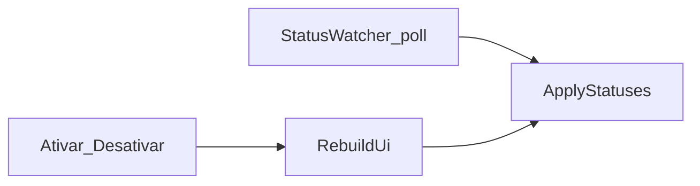

# Plano: anti-flicker + backup diário + status na tray

**Status:** aguardando confirmação para implementar  
**Overview:** Eliminar o piscar da UI atualizando cards in-place no poll; backup automático diário com sobrescrita do slot `auto/`; backups manuais nomeados; e status atual visível na bandeja sob cada serviço (9Router / OmniRoute).

## Decisões fechadas

- **Flicker:** poll/status só atualiza labels in-place; `RebuildUi` só quando a lista enabled/disabled muda (Ativar/Desativar/Recarregar/seed).
- **Backup automático:** 1× por dia, enquanto o Z-Lab estiver aberto; pasta fixa sobrescrita por serviço.
- **Escopo automático:** todos `enabled` com `backup.mode == volumeCopy` (hoje 9router + omniroute).
- **Backup manual:** cria artefato **novo** com carimbo ou nome informado (não sobrescreve o slot `auto`).
- **Horário padrão:** `03:00` local; configurável em `settings.backupDailyTime` (`HH:mm`). Se `backupFolder` estiver vazio, o job **não roda** (aviso discreto uma vez).
- **Tray:** abaixo do nome de cada serviço enabled (no mínimo 9Router e OmniRoute), uma **linha de status** não clicável, atualizada ao abrir o menu.

## 1. Anti-flicker ([MainForm.cs](src/ZLab/MainForm.cs))

**Problema:** `OnSnapshot` / `RefreshStatusesAsync` / `RequestRefresh` chamam `RebuildUi()` → `Controls.Clear()` + recria cards.

**Solução:**

1. Dicionários `_activeCards` / `_catalogRows` (`id` → `statusLabel` + card/row).
2. Separar:
   - `RebuildUi()` — mount completo (só mudança estrutural).
   - `ApplyStatuses()` — atualiza texto/cor de status e busy **sem** Clear.
3. `OnSnapshot` e fim de `RefreshStatusesAsync` → **só** `ApplyStatuses()`.
4. Após Ativar/Desativar/Reload → `RebuildUi()` + refresh status.
5. Após Iniciar/Parar: busy + status in-place; rebuild só se enabled mudou.
6. Opcional: DoubleBuffered no form/painéis.



## 2. Status na tray ([TrayApp.cs](src/ZLab/TrayApp.cs))

**Hoje:** `RebuildMenu()` cria submenu só com o `DisplayName` e ações (Iniciar/Parar/…), sem status.

**Alvo (por item enabled, tipicamente 9Router e OmniRoute):**

```text
Abrir painel
—
9Router
  Status: Up          ← item Enabled=false (não executa ação)
  ────────
  Iniciar
  Parar
  …
OmniRoute
  Status: Exited
  ────────
  Iniciar
  …
—
Sair
```

Detalhes:

1. Em `RebuildMenu()` (já dispara em `_menu.Opening`): para cada serviço enabled, primeiro item do dropdown = texto `Status: {Up|Exited|Não encontrado|…}` com `Enabled = false`, depois separator, depois ações.
2. Fonte do status: cache do `StatusWatcher` / último snapshot (mesmo mapa do painel); se ainda não houver, `Status: …`.
3. Tooltip do `NotifyIcon`: `Z-Lab — 9R: Up | Omni: Up` (resumo dos enabled), atualizado no poll.
4. Escopo: **todos** os serviços `enabled` no menu (9router/omniroute entram naturalmente).

## 3. Backup diário sobrescrevendo slot auto

### Layout em disco

Sob `settings.backupFolder`:

| Tipo | Caminho | Comportamento |
|------|---------|----------------|
| Automático | `{backupFolder}\auto\{id}\` | **Sobrescreve** a cada run diário |
| Manual | `{backupFolder}\{id}_{yyyy-MM-dd_HHmm}\` ou `{id}_{nome}` | Pasta **nova**; não toca em `auto/` |

### Settings (JSON)

Em `settings` + seed em [config/services.default.json](config/services.default.json):

- `backupDailyEnabled`: `true`
- `backupDailyTime`: `"03:00"`
- `lastAutoBackupDate`: `""` (após sucesso do ciclo)

### Serviço: `ScheduledBackupService` (ZLab.Core)

- Loop em background enquanto o app está vivo.
- Se enabled, pasta configurada, ainda não rodou hoje, e hora ≥ `backupDailyTime` → backup de todos elegíveis para `auto/{id}` (overwrite).
- Automático **quente** (sem prompt Stop/Start); falha → balloon; retry no máx. a cada 30 min no mesmo dia.
- Sucesso do ciclo → grava `lastAutoBackupDate`.
- Start no TrayApp/Program; stop no Sair.

### Manual

- Diálogo “Nome do backup” (vazio = stamp; senão `{id}_{nome}` sanitizado).
- Botões Backup existentes usam o fluxo manual.

## 4. Docs

- Atualizar [docs/SPEC-ZLAB.md](docs/SPEC-ZLAB.md) §6.5 (agendamento) e §7.2 (tray com status sob o nome).
- Atualizar [.docs/specs/backup-data.spec.md](.docs/specs/backup-data.spec.md) e tray/status specs.
- Nota anti-flicker em tech-debt ou ui-ux.

## 5. Testes + publish

- Naming: `auto/{id}` vs stamp/custom.
- “Deve rodar hoje?” com relógio injetável.
- `dotnet test` + `dotnet publish` win-x64 no WSL.
- Smoke: painel sem piscar; menu tray com Status sob 9Router/OmniRoute; manual com nome; pastas `auto/` sobrescritas.

## Todos

1. MainForm: ApplyStatuses in-place; RebuildUi só em mudança de catálogo
2. TrayApp: status não clicável sob cada serviço enabled + tooltip resumido
3. BackupService slot auto/ + ScheduledBackupService + settings JSON
4. UI backup manual com nome opcional
5. SPEC/specs + testes + publish
