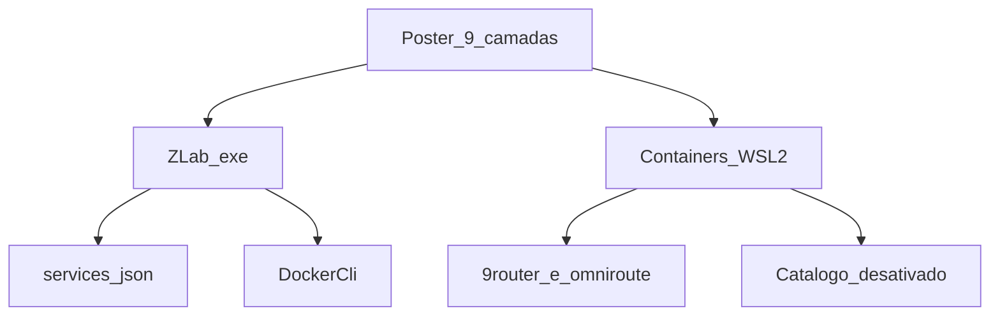

# Roteiro de decisão: pilha 2026 vs Z-Lab

**Status:** registro de decisão (sem implementação)  
**Autoridade de produto:** [`docs/SPEC-ZLAB.md`](../../docs/SPEC-ZLAB.md) v0.5 — este arquivo não a substitui  
**Contexto:** pôster “The Full System Design + AI Stack — 2026–27” (nove camadas) cruzado com a documentação e o fluxo atuais  
**Fora deste registro:** código, ativação de itens do catálogo, bump de SPEC / requirements / technologies, pipeline `@zteam` full

Se este arquivo e a SPEC divergirem, a SPEC ganha até as duas serem atualizadas juntas.

---

## 1. Dois sujeitos

O pôster descreve um produto distribuído. Este repositório tem dois sujeitos:

- **Operador** — `ZLab.exe`: bandeja WinForms, catálogo JSON em `%AppData%\ZLab\services.json`, acesso ao engine via `DockerCli` (`docker.exe` ou `wsl docker`). [`.docs/technologies.md`](../technologies.md) §1 e §5 já fecham servidor HTTP, barramento, banco e SaaS dentro do exe.
- **Lab** — containers que o operador liga. Habilitados no seed: `9router` (porta 20128) e `omniroute` (20129→20128). O restante de [`config/services.default.json`](../../config/services.default.json) fica visível e `enabled: false`.

Um **adotar** no lab não autoriza o exe a ganhar API, fila ou banco.

## 2. Vocabulário

- **Adotar** — já é o caminho, ou entra como regra operacional sem feature nova de produto.
- **Adiar** — só reabre com um gatilho nomeado (quem consome, qual dado, qual dor).
- **Rejeitar** — contradiz a V1 (SPEC §2.3, technologies §1 non-choices, §6) ou empurra SaaS/cloud neste lab.

**Rede:** IPv4 only ([`.cursor/rules/no-ipv6.mdc`](../../.cursor/rules/no-ipv6.mdc), [`scripts/fix-wsl-docker-ipv4.sh`](../../scripts/fix-wsl-docker-ipv4.sh)). CloudFront no pôster, neste lab, é o sintoma de `docker pull` quebrado em AAAA — não é componente a adotar.

Cada camada abaixo usa o mesmo miolo: o que o pôster lista, o que existe hoje, veredito do operador, veredito do lab, porquê, gatilho quando o veredito é adiar.

---

## 3. Clients e interfaces

**Pôster:** React, Next.js, Flutter, Swift, Kotlin, React Native.

**Hoje:** UI do operador é WinForms (`net8.0-windows`), bandeja + painel, cópia PT-BR (technologies §1; [`.docs/requirements.md`](../requirements.md) FR-UX). O lab abre dashboards no browser via `openUrl`: `http://localhost:20128` (9Router) e `http://127.0.0.1:20129` (OmniRoute). Hosts locais `9router-local` / `omniroute-local` isolam cookies (SPEC §1.1).

| Sujeito | Veredito |
|---------|----------|
| Operador | **Rejeitar** React, Next.js, Flutter, Swift, Kotlin e React Native. A UI permanece WinForms. |
| Lab | **Adotar** o browser que já abre `openUrl`. Não criar app cliente neste repositório. |

**Porquê:** technologies §1 lista Electron e shell web entre os non-choices da V1. O consumidor do lab já é o browser do operador (e, na LAN, quem alcança a porta exposta — persona “Usuário LAN” na SPEC §3, sem UI própria).

**Gatilho:** nenhum. Um segundo cliente só entra com revisão explícita da SPEC.

---

## 4. Edge, DNS e tráfego

**Pôster:** Cloudflare, AWS Route 53, NGINX, Envoy, AWS CloudFront, HAProxy.

**Hoje:**

- `LanExposeHelper` — `netsh` portproxy + regra de firewall, opt-in por `exposeLan` (FR-LAN; technologies §1).
- 9Router: `exposeLan: true`, regra `ZLab 9Router 20128`; botão Tunnel no card (token CLI). A UI no browser Windows mostra “Local only” — esperado (nota do seed e SPEC §1.1).
- OmniRoute: `exposeLan: true`, porta 20129; Cloud OmniRoute (sync) é distinto do Cloudflare Quick Tunnel, que se liga no dashboard Endpoints e não sobrevive a restart (nota do seed).
- IPv4 only. CloudFront entra na documentação como falha de pull (`dial tcp [2600:…]`), corrigida pelo script de pin A, não como CDN do produto.

| Sujeito | Veredito |
|---------|----------|
| Operador | **Adotar** portproxy, firewall, Tunnel e hosts locais já especificados. **Rejeitar** NGINX, Envoy, HAProxy, Route 53 e CloudFront como parte do exe. |
| Lab | **Adiar** tratar Quick Tunnel / Cloudflare como malha de borda. O uso pontual já está na nota do card. |

**Porquê:** a borda deste lab é o Windows host (portproxy para o IP do WSL, que muda após `wsl --shutdown`). Colocar proxy de serviço ou DNS de cloud dentro do operador duplica o que o catalog item e o script IPv4 já cobrem.

**Gatilho (lab):** um dispositivo fora da LAN precisa alcançar 9Router ou OmniRoute de forma estável, e o Tunnel atual (CLI token / Quick Tunnel que não restaura) deixa de servir. Aí o desenho é operacional (como o operador sobe o túnel), não um novo produto de edge.

---

## 5. APIs e service layer

**Pôster:** REST, GraphQL, gRPC, Kong, Apigee, AWS API Gateway.

**Hoje:** o Z-Lab não é servidor HTTP (technologies §5). Fronteiras locais: `DockerCli`, `ServiceCatalogStore`, `LanExposeHelper`, e `openUrl` aberto pelo SO. No lab, a camada de API de modelos são os gateways habilitados (`category: gateway`). Templates desativados: `generic-api` (placeholder `nginx:alpine` na 8080) e `n8n` (também citado na camada de workflows).

| Sujeito | Veredito |
|---------|----------|
| Operador | **Rejeitar** REST, GraphQL, gRPC, Kong, Apigee e API Gateway dentro do Z-Lab. |
| Lab | **Adotar** 9Router e OmniRoute como a camada de API de modelos. **Adiar** `generic-api` e qualquer gateway novo até existir consumidor. |

**Porquê:** technologies §5 deixa explícito que não há superfície OpenAPI na V1. Os gateways já são o serviço que clientes (Cursor, zteam, browser) chamam. `generic-api` é placeholder para trocar `image` / portas no JSON — não é um contrato.

**Gatilho (lab):** um programa concreto precisa de uma API que não seja 9Router nem OmniRoute. Aí ativa-se ou edita-se `generic-api` no JSON (FR-CAT-06), sem servidor dentro do exe.

---

## 6. Messaging e workflows

**Pôster:** Apache Kafka, RabbitMQ, Amazon SQS, NATS, Temporal, Apache Pulsar.

**Hoje:** nenhum barramento no operador nem no catálogo. technologies §6: não introduzir message bus para o tamanho do catálogo (~10–30 itens). O fluxo de trabalho do time é o zteam — SA → TA → UX → SE → QA ([`.zteam/README.MD`](../../.zteam/README.MD), topologia em [`.zteam/langgraph/README.md`](../../.zteam/langgraph/README.md)). Isso é pipeline de desenvolvimento, não runtime do lab. No seed, `n8n` (`enabled: false`, nota “Automação / workflows HTTP”) é o único template de workflow. A nota de `redis` diz “Cache / filas”; o item continua desativado e pertence à camada de dados.

| Sujeito | Veredito |
|---------|----------|
| Operador | **Rejeitar** Kafka, RabbitMQ, SQS, NATS, Temporal e Pulsar. |
| Lab | **Adiar** `n8n` como automação HTTP local. **Rejeitar** barramento distribuído para um operador só. |

**Porquê:** o loop do operador é síncrono e por item (Iniciar, Parar, poll de 8s). O zteam já orquestra o trabalho de implementação via MCP / LangGraph de desenvolvimento; embutir Temporal ou Kafka no exe ou no lab não atende nenhum FR da V1.

**Gatilho (lab):** uma automação repetida (backup externo, webhook, encadeamento entre containers) não cabe num clique do painel nem num script solto. Aí avalia-se ativar `n8n`, não um cluster de mensageria.

---

## 7. Data, storage e cache

**Pôster:** PostgreSQL, MySQL, MongoDB, DynamoDB, Redis, Amazon S3.

**Hoje:** persistência do operador é arquivo — seed `config/services.default.json`, runtime `%AppData%\ZLab\services.json`, backups em `settings.backupFolder` com `volumeCopy` (technologies §4; FR-CAT, FR-BKP). Sem ORM e sem banco (technologies §1). Templates desativados no seed: `postgres` (16, `backup.mode: none`, nota aponta `pgDump` como V2), `mysql` (8), `mongodb` (7), `redis` (7, `volumeCopy`). DynamoDB e S3 não aparecem.

| Sujeito | Veredito |
|---------|----------|
| Operador | **Adotar** JSON + volumes Docker + `volumeCopy`. **Rejeitar** Postgres, MySQL, Mongo, DynamoDB e S3 como persistência do catálogo. |
| Lab | **Adiar** `postgres`, `mysql`, `mongodb` e `redis` até um serviço habilitado precisar deles. |

**Porquê:** o catálogo tem dezenas de itens, não um domínio relacional. SPEC §10 reserva `pgDump` e health de engine para V2; o pôster não antecipa essa rampa. Backup diário e anti-flicker seguem o plano local [flicker-and-daily-backup.md](flicker-and-daily-backup.md), ainda no operador, sem banco.

**Gatilho (lab):** um container habilitado precisa de estado que o volume do próprio serviço não guarda (ou precisa de cache compartilhado). Aí ativa-se o template correspondente no JSON, com senha fora de `CHANGE_ME`, e `backup.mode` revisto. `pgDump` continua mudança de SPEC (RF20), não efeito deste pôster.

---

## 8. Search, vector e retrieval

**Pôster:** Elasticsearch, OpenSearch, Milvus, Pinecone, Weaviate, pgvector.

**Hoje:** nenhum item de busca ou vetor no catálogo, nenhum cliente no código do Z-Lab, nenhum corpus descrito na SPEC ou nos requirements.

| Sujeito | Veredito |
|---------|----------|
| Operador | **Rejeitar** motor de busca ou vetor dentro do exe. |
| Lab | **Rejeitar** Elasticsearch, OpenSearch, Milvus, Pinecone e Weaviate agora. **Adiar** retrieval até existir corpus e uma pergunta. |

**Porquê:** não há documentos nem consulta para indexar. Pinecone (e qualquer SaaS de vetor) ainda esbarra na regra de não puxar SaaS para a V1 (technologies §1 e §7).

**Gatilho (lab):** há um conjunto de documentos e uma pergunta que o gateway de modelos precisa responder com trechos desses documentos. Se reabrir, o candidato local é `pgvector` em cima do template `postgres` já presente no seed — um container a mais no lab, não um serviço gerenciado.

---

## 9. AI, RAG e agents

**Pôster:** OpenAI, Claude, Gemini, LangGraph, LlamaIndex, MCP.

**Hoje:**

- Lab habilitado: `9router` e `omniroute`, ambos `category: gateway`, `managed: true`, backup `volumeCopy`. São o acesso a modelos (provedores entram por esses gateways, não por SDK dentro do Z-Lab).
- Desativado: `ollama` (`category: llm`, porta 11434; nota pede GPU/recursos). Mídia no mesmo seed, fora do pôster: `comfyui`, `whisper`, `piper-tts` — permanecem adiar, sem promoção por este registro.
- Desenvolvimento: LangGraph e MCP são o orquestrador zteam (workflow `docs` / `feature` / `tests` / `full`), com modelos em `.zteam/config.json`. Não são serviço do lab nem biblioteca do exe.

| Sujeito | Veredito |
|---------|----------|
| Operador | **Rejeitar** embutir runtime de agente, RAG ou SDK de provedor no exe. |
| Lab | **Adotar** 9Router + OmniRoute como acesso a modelos. **Adiar** `ollama` e qualquer RAG (LangGraph, LlamaIndex ou MCP como produto do lab). |

**Porquê:** o problema que a SPEC §2.2 resolve é operar containers, não responder com recuperação de contexto. O zteam já usa LangGraph/MCP para construir o Z-Lab; duplicar isso como container “porque o pôster lista” mistura pipeline de time com runtime.

**Gatilho:** `ollama` quando um fluxo precisar de modelo local e a máquina tiver recurso (a nota do seed já condiciona GPU). RAG quando o gatilho da camada 8 disparar (corpus + pergunta) — a orquestração fica no lab ou no cliente que chama o gateway, não no `ZLab.exe`.

---

## 10. Evaluation, compute e deployment

**Pôster:** AWS Lambda, Kubernetes, GitHub Actions, Docker, Google Cloud Run, Terraform. A faixa também nomeia “Evaluation”.

**Hoje:** containers no Docker Engine 29.x dentro do WSL2 Ubuntu 24.04 (SPEC §1.1). Build e teste no README: `dotnet test ZLab.sln -c Release` e `dotnet publish … -r win-x64` a partir do SDK WSL 8.0.425, saída local `publish/ZLab`. technologies §9 descreve a ordem lint → test → build; não há workflow em `.github/` no repositório. Sem Lambda, Kubernetes, Cloud Run ou Terraform. Sem suite de avaliação de prompts ou agentes.

| Sujeito | Veredito |
|---------|----------|
| Operador | **Adotar** Docker no WSL2 e o publish `win-x64` atual. **Adiar** um job único de CI (lint → test → build). **Rejeitar** Lambda, Kubernetes, Cloud Run e Terraform para este desktop. |
| Lab | **Adotar** Docker como o compute dos itens. **Adiar** evaluation de prompts/agentes até existir fluxo de IA estável para medir. |

**Porquê:** technologies §3 fixa hosting em processo Windows local, sem cloud. CI “single job” já é a expectativa escrita (§9) e ainda não está materializada — adiar nomeia essa lacuna sem inventar plataforma. Evaluation sem um fluxo fechado (gateway + tarefa) mede ruído.

**Gatilho (CI):** o exe precisa ser publicado para outra máquina, ou um contribuidor quebra `dotnet test` sem um gate. O job espelha §9.3–§9.4; Docker-in-CI continua fora (testes mockam `DockerCli`).  
**Gatilho (evaluation):** 9Router ou OmniRoute tem um conjunto fixo de chamadas cujo resultado o operador quer comparar entre modelos. Aí a avaliação é um artefato à parte (script ou teste), não um cluster.

---

## 11. Security e observability

**Pôster:** OAuth 2.0, OpenID Connect, Prometheus, Grafana, Datadog, HashiCorp Vault, OpenTelemetry.

**Hoje:** sem autenticação in-app — operador local confiável (technologies §8). Elevação só em `LanExposeHelper`. Segredos ficam no JSON de runtime (`INITIAL_PASSWORD`, `CHANGE_ME`); não vão para log nem notificação (NFR-04). Backup avisa que pode conter chaves (FR-BKP-06). Proibido prune e apagar volume (NFR-05, RNF06). Observabilidade do operador: `StatusWatcher` a cada `pollSeconds` (default 8), notificação só em transição de item `managed && enabled`, logs com `logTailLines` (default 80), stats quando Up. Health V1 é `health.type: docker`. HTTP/TCP é Could V2 (SPEC RF20, FR-OUT-01). Sem Prometheus, Grafana, Datadog, Vault ou OpenTelemetry.

| Sujeito | Veredito |
|---------|----------|
| Operador | **Adotar** confiança local, higiene de segredo e o poll/logs/bandeja atuais. **Rejeitar** OAuth 2.0, OpenID Connect, Datadog, Vault e OpenTelemetry como produto V1. |
| Lab | **Adotar** logs e status por item como a observabilidade do dia a dia. **Adiar** health HTTP/TCP (já V2 na SPEC), sem puxar Prometheus ou Grafana antes disso. |

**Porquê:** OAuth protegeria um servidor que o Z-Lab não é. Telemetria SaaS está na lista “No” de technologies §7. Métricas de cluster não mudam o contrato de notificação (transição, baseline silencioso no primeiro poll).

**Gatilho:** health HTTP/TCP quando o estado Docker deixar de bastar para um item habilitado (container Up e serviço morto). Isso é RF20 / V2, com campo `health` já reservado — ainda local, ainda sem stack de métricas. Prometheus/Grafana só voltam à mesa se vários itens habilitados no dia a dia precisarem de histórico que o tail de logs não dá.

---

## 12. Matriz

| Camada | Operador | Lab | Gatilho que reabre o adiar |
|--------|----------|-----|----------------------------|
| 1. Clients e interfaces | Rejeitar frameworks do pôster; ficar em WinForms | Adotar browser via `openUrl` | Nenhum sem revisão da SPEC |
| 2. Edge, DNS e tráfego | Adotar portproxy, firewall, Tunnel, hosts locais. Rejeitar NGINX, Envoy, HAProxy, Route 53, CloudFront no exe | Adiar malha Cloudflare; uso pontual já está na nota do card | Acesso estável fora da LAN, além do Tunnel atual |
| 3. APIs e service layer | Rejeitar servidor HTTP / gateway no exe | Adotar 9Router e OmniRoute. Adiar `generic-api` | Uma API que não seja esses dois gateways |
| 4. Messaging e workflows | Rejeitar barramento no exe. zteam permanece pipeline de desenvolvimento | Adiar `n8n`. Rejeitar Kafka, Rabbit, SQS, NATS, Temporal, Pulsar | Automação repetida que não cabe no painel nem num script |
| 5. Data, storage e cache | Adotar JSON + volumes + `volumeCopy`. Rejeitar banco/S3 para o catálogo | Adiar `postgres`, `mysql`, `mongodb`, `redis` | Item habilitado precisa de estado ou cache que o próprio volume não guarda |
| 6. Search, vector e retrieval | Rejeitar motor de busca no exe | Rejeitar os motores do pôster agora. Adiar retrieval | Corpus e uma pergunta a responder; candidato local `pgvector` no template Postgres |
| 7. AI, RAG e agents | Rejeitar agente/RAG/SDK no exe | Adotar os dois gateways. Adiar `ollama` e RAG de produto. Mídia do seed (`comfyui`, `whisper`, `piper-tts`) continua adiar | Modelo local com recurso de GPU; RAG quando o gatilho da camada 6 disparar |
| 8. Evaluation, compute e deployment | Adotar Docker WSL2 + publish `win-x64`. Adiar CI lint→test→build. Rejeitar Lambda, Kubernetes, Cloud Run, Terraform | Adotar Docker. Adiar evaluation de prompts | Publicar o exe noutra máquina ou segurar `dotnet test`; conjunto fixo de chamadas a comparar |
| 9. Security e observability | Adotar confiança local, higiene de segredo, poll e logs. Rejeitar OAuth, OIDC, Datadog, Vault, OpenTelemetry na V1 | Adotar logs/status por item. Adiar health HTTP/TCP (V2, RF20) | Container Up com serviço morto; Prometheus/Grafana só se o tail deixar de bastar |

---

## 13. O que este registro não faz

- Não altera [`.docs/todo.md`](../todo.md). Os sete slugs da V1 seguem o critério de pronto que já está lá.
- Não autoriza `@zteam` / `workflow: full` para “implementar a pilha”.
- Não ativa itens do catálogo e não edita a SPEC para caber no pôster.
- Não trata CloudFront, Datadog, Pinecone, Vault ou API Gateway como próximo passo operacional. O próximo passo operacional de rede continua a ser IPv4 only quando um pull falhar em AAAA.

Quem for implementar alguma linha **adotar** que ainda não está no código deve partir do FR/RF citado — não deste pôster. Quem for reabrir uma linha **adiar** precisa do gatilho da matriz escrito no pedido, mais a SPEC se o comportamento da V1 mudar.
