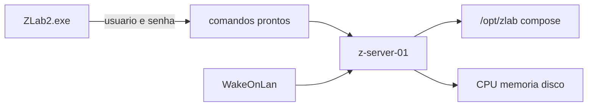

# Z-Lab 2.0: monitor do z-server-01

**Status:** plano do monitor (sem implementação)  
**Exe:** `ZLab.exe`, WinForms, .NET 8, neste repositório — [`.docs/technologies.md`](../technologies.md) §1  
**Máquina:** [z-server-01](../../../z-server-01/README.md) — Ubuntu, `melchior`, `192.168.2.37`, Compose em `/opt/zlab`  
**Fonte do que roda:** [`zlab/docker-compose.yml`](../../../z-server-01/zlab/docker-compose.yml) (projeto `zlab`), já copiado em `/opt/zlab`  
**Fora deste arquivo:** código C#, edição de [`config/services.default.json`](../../config/services.default.json), desligar container no WSL

A SPEC v0.5 ([`docs/SPEC-ZLAB.md`](../../docs/SPEC-ZLAB.md)) descreve o operador atual, que fala com o Docker do WSL. Este arquivo é o contrato da versão seguinte. Não substitui a SPEC; quem for implementar o 2.0 parte daqui e só altera a SPEC quando o comportamento da V1 mudar de propósito.

O Z-Lab 2.0 continua um programa C# de bandeja. O alvo passa a ser o z-server-01. O engine Docker do WSL deixa de ser o lugar do 9Router, do OmniRoute, do MausBot e do Tailscale.



---

## 1. Dois lugares

Hoje o `ZLab.exe` fala com `wsl docker` em [`DockerCli.cs`](../../src/ZLab.Core/Services/DockerCli.cs). O catálogo em [`config/services.default.json`](../../config/services.default.json) cria `9router` e `omniroute` com `docker run` no WSL, abre `localhost` e expõe a LAN com portproxy para o IP do WSL. O card Tailscale desse catálogo é um container só: `containerName` `tailscale-9router`, `TS_EXTRA_ARGS` com `tag:9router`, nota de porta 8443 para o OmniRoute.

No servidor o mesmo nome de produto já está em outra forma. Docker CE 29.9.1 e Compose v5.6.0. O arquivo em `/opt/zlab` tem seis serviços. Três sobem no `up` normal. Três só entram com `--profile tailnet`.

| Serviço | Perfil | Container | Imagem | Rede no servidor |
|---------|--------|-----------|--------|------------------|
| `9router` | padrão | `9router` | `decolua/9router:latest` | `20128:20128`, volume `9router-data` |
| `omniroute` | padrão | `omniroute` | `diegosouzapw/omniroute:latest` | `20129:20128`, volume `omniroute-data` |
| `mausbot` | padrão | `mausbot` | `ghcr.io/milind-soni/openmausbot:latest` | `network_mode: host`, volume `mausbot-data` |
| `tailscale` | `tailnet` | `tailscale` | `tailscale/tailscale:latest` | host, userspace, hostname `zlab`, `tag:zlab` |
| `tailscale-9router` | `tailnet` | `tailscale-9router` | `tailscale/tailscale:latest` | host, userspace, hostname `9router-serve`, `tag:ninerouter` |
| `tailscale-mausbot` | `tailnet` | `tailscale-mausbot` | `tailscale/tailscale:latest` | host, userspace, hostname `mausbot-serve`, `tag:mausbot` |

O nome do container coincide com o nome do serviço. O monitor usa essa lista fechada. Não há campo para inventar um sétimo nome.

O PC que abre o exe é o NBPITANG-491 (`192.168.2.36`, Wi-Fi). O shell desse PC é o Windows PowerShell 5: `;` separa comandos, `&&` não existe. O monitor herda essa restrição: atualizar um serviço são duas invocações, nunca uma string com `&&`.

---

## 2. Login, sempre com usuário e senha

Cada sessão pede usuário e senha. A chave SSH sozinha não abre o monitor. A chave `C:\Users\htzc\.ssh\id_ed25519_zserver` continua no PC para o uso humano já documentado no README do servidor; o `ZLab.exe` não a usa para entrar.

O alvo é fixo: `192.168.2.37`, porta 22. A conta que existe hoje é `melchior`. O diálogo ainda pede o usuário, para a sessão não nascer de um arquivo. A senha fica só na memória da sessão (buffer zerado ao fechar o exe ou ao encerrar a sessão). Não entra no Git, não entra em `%AppData%\ZLab\services.json`, não entra no seed `services.default.json`, não entra em log e não aparece em `argv`.

O pedido de senha usa um destes dois caminhos, os dois com a senha fora da linha de comando:

- um askpass de vida curta, ligado por `SSH_ASKPASS` e `SSH_ASKPASS_REQUIRE=force`, que recebe a senha do processo pai por handle herdado ou pela entrada padrão, nunca por argumento;
- uma API SSH dentro do processo, que recebe a senha em memória.

A invocação do cliente, quando o caminho for o `ssh.exe`, leva `PreferredAuthentications=password`, `PubkeyAuthentication=no` e `NumberOfPasswordPrompts=1`. Com isso a chave em disco não satisfaz o login. `StrictHostKeyChecking=yes`: a entrada já conhecida de `192.168.2.37` em `known_hosts` permanece; chave de host nova ou trocada interrompe a sessão.

`TS_AUTHKEY` fica nos `.env` do servidor (`/opt/zlab/tailscale/.env`, `tailscale-9router/.env`, `tailscale-mausbot/.env`), modo 600, fora do Git. O monitor não lê e não grava esses arquivos.

---

## 3. Lista fechada no sudoers

Observar a máquina, controlar os serviços do Compose e criar um container que já está no arquivo cabem no perfil. Apagar container, volume, imagem ou o arquivo Compose fica de fora. O grupo `docker` é largo demais para isso: quem está no grupo fala com o socket e consegue `docker rm` sem passar pelo sudo. A trava do perfil é o sudoers, não a associação solta ao socket.

Hoje, no servidor, as duas coisas largas existem: `melchior` está no grupo `docker`, e `/etc/sudoers.d/melchior-nopasswd` concede sudo sem senha para o resto. Enquanto isso for verdade, uma sessão SSH interativa ignora qualquer lista estreita. O perfil do monitor só segura de verdade quando esse arquivo genérico sai e a conta deixa o grupo `docker`. O exe, mesmo antes disso, só emite os argv desta seção.

A conta do monitor chama Docker e energia com `sudo`. A lista é `NOPASSWD` só para os comandos abaixo, para a senha da sessão SSH não ser reenviada. Não há `ALL`. Não há curinga que aceite `down`, `rm`, `prune` ou um shell. `visudo` confere a sintaxe no servidor. Os caminhos são os que `command -v` devolver no Ubuntu 26.04 (`docker`, `uptime`, `cat`, `free`, `df`, `shutdown`, `reboot`). Se `reboot` for link para `systemctl`, a entrada nomeia esse caminho invocado pelo botão, não um `systemctl *`.

Prefixo Compose, serviços padrão (`9router`, `omniroute`, `mausbot`):

```text
/usr/bin/docker compose --project-directory /opt/zlab -f /opt/zlab/docker-compose.yml
```

O mesmo prefixo com `--profile tailnet` logo após `compose`, para `tailscale`, `tailscale-9router` e `tailscale-mausbot`. Sem esse perfil o Compose não enxerga os três nós, e um `up -d` não os cria.

| Botão | Argumentos permitidos | O que faz |
|-------|----------------------|-----------|
| Subir | `start <serviço>` | Liga um container que já existe |
| Parar | `stop <serviço>` | Para esse container; o volume fica |
| Atualizar | `pull <serviço>`, depois `up -d <serviço>` | Duas chamadas. A segunda só sai se o pull terminar com código 0. O `up -d` recria o container se a imagem mudou; o volume nomeado permanece |
| Criar | `up -d <serviço>` | Cria o serviço que já está no arquivo e ainda não tem container |
| Estado | `ps -a --format json <serviço>` | Estado desse serviço, inclusive parado |
| Log | `logs --tail 80 <serviço>` | Últimas 80 linhas, uma leitura só, sem `-f` |
| Uso | `docker stats --no-stream --format {{.CPUPerc}}/{{.MemUsage}}/{{.PIDs}} <serviço>` | Uma amostra. Fora do `compose`, no binário `docker` |

`<serviço>` é um dos seis nomes da tabela da seção 1. O programa concatena só esses identificadores. Uso:

```text
/usr/bin/docker stats --no-stream --format {{.CPUPerc}}/{{.MemUsage}}/{{.PIDs}} 9router
```

Observar a máquina, também na lista, uma forma por leitura:

```text
/usr/bin/uptime
/usr/bin/cat /proc/loadavg
/usr/bin/free -h
/usr/bin/df -h /
/usr/bin/df -h /var/lib/docker
/usr/bin/df -h /data
```

`/data` ainda não está montado (Hitachi `sdb`, tarefa 06). A leitura de `/data` só entra quando o ponto de montagem existir; até lá o painel mostra a ausência, sem criar o diretório.

Energia, só estas duas linhas (seção 9):

```text
/usr/sbin/shutdown -h now
/usr/sbin/reboot
```

Fora da lista, e portanto sem botão e sem argv gerável:

- `docker compose down`, `docker compose rm`, `docker rm`, `docker stop` solto
- `docker volume rm`, `docker volume prune`
- `docker image rm`, `docker image prune`, `docker system prune`
- `docker exec` (seria um shell dentro do container)
- apagar ou reescrever `/opt/zlab/docker-compose.yml`
- ler ou gravar `TS_AUTHKEY`
- `sudo -i`, `sudo su`, `sudo bash`, `sudo sh`, qualquer shell de root

Os volumes que o perfil não apaga: `9router-data`, `omniroute-data`, `mausbot-data`, `tailscale-state`, `tailscale-9router-state`, `tailscale-mausbot-state`.

---

## 4. Acesso sem caixa de comando livre

A pessoa aperta botão. Não digita shell.

O executor preferido é um runspace do Windows PowerShell 5 hospedado no processo. Cada botão dispara um script fixo, sem caixa de texto e sem pipeline montado pelo operador. O Wake-on-LAN cabe inteiro nesse runspace: é UDP local, o mesmo pacote da seção 8.

O exe é `net8.0-windows`. O PowerShell 5.1 é .NET Framework. Se o processo não conseguir carregar esse runspace, o fallback é `ssh.exe` com argumentos fixos: usuário, host, opções da seção 2, e um único comando remoto escolhido na tabela da seção 3. Nos dois caminhos a lista é fechada. Não existe campo para um comando novo.

O comando remoto não pede TTY (`-t` fica de fora). Não há `bash -lc` com uma string livre no meio.

---

## 5. Observabilidade do servidor

O painel lê a máquina no intervalo que o operador já usa (`pollSeconds`, padrão 8, em `settings` do catálogo). Cada tick é uma leitura pronta, não um script colado na hora:

| Leitura | Comando | O que o painel mostra |
|---------|---------|------------------------|
| Tempo ligado e carga | `uptime` | Há quanto tempo a máquina está no ar, usuários, carga de 1, 5 e 15 minutos |
| Carga crua | `cat /proc/loadavg` | Os três números, mais o processo em execução |
| Memória | `free -h` | Total, usado, livre, cache |
| Disco `/` | `df -h /` | LV `ubuntu-lv`, 50 GB, ext4 |
| Disco do Docker | `df -h /var/lib/docker` | LV `docker-lv`, 150 GB |
| Disco de dados | `df -h /data` | Quando `/data` existir |

CPU e carga vêm dessas duas primeiras linhas. Não há agente, Prometheus nem Grafana: o contrato do dia a dia continua sendo leitura pontual mais o log e o `stats` por serviço (technologies §1 e o registro [stack-2026-decision.md](stack-2026-decision.md) §11). Health HTTP/TCP de cada porta continua fora, como já está na SPEC (RF20).

---

## 6. Gestão dos containers do Compose

A pasta de trabalho remota é `/opt/zlab`. O `-f` e o `--project-directory` vão em todo argv, para o comando não depender do diretório em que o SSH caiu. O plugin é `docker compose` (com espaço).

Um card por serviço, com os sete botões da seção 3. Exemplo fechado, 9Router:

```text
sudo -n /usr/bin/docker compose --project-directory /opt/zlab -f /opt/zlab/docker-compose.yml start 9router
sudo -n /usr/bin/docker compose --project-directory /opt/zlab -f /opt/zlab/docker-compose.yml stop 9router
sudo -n /usr/bin/docker compose --project-directory /opt/zlab -f /opt/zlab/docker-compose.yml pull 9router
sudo -n /usr/bin/docker compose --project-directory /opt/zlab -f /opt/zlab/docker-compose.yml up -d 9router
sudo -n /usr/bin/docker compose --project-directory /opt/zlab -f /opt/zlab/docker-compose.yml ps -a --format json 9router
sudo -n /usr/bin/docker compose --project-directory /opt/zlab -f /opt/zlab/docker-compose.yml logs --tail 80 9router
sudo -n /usr/bin/docker stats --no-stream --format {{.CPUPerc}}/{{.MemUsage}}/{{.PIDs}} 9router
```

`start` falha se o container ainda não foi criado. O botão Criar é o `up -d` dessa lista. Atualizar é o `pull` e, em seguida, o mesmo `up -d`. Não há `compose down`.

O MausBot no servidor escuta em `127.0.0.1:8799` (UI) e `127.0.0.1:8800` (webhooks). Essas portas não são URL da LAN.

---

## 7. Perfil tailnet, LAN e nomes HTTPS

Os três nós Tailscale estão no perfil `tailnet`. Todo verbo Compose deles leva `--profile tailnet`. Exemplo, nó do 9Router:

```text
sudo -n /usr/bin/docker compose --profile tailnet --project-directory /opt/zlab -f /opt/zlab/docker-compose.yml start tailscale-9router
sudo -n /usr/bin/docker compose --profile tailnet --project-directory /opt/zlab -f /opt/zlab/docker-compose.yml pull tailscale-9router
sudo -n /usr/bin/docker compose --profile tailnet --project-directory /opt/zlab -f /opt/zlab/docker-compose.yml up -d tailscale-9router
sudo -n /usr/bin/docker compose --profile tailnet --project-directory /opt/zlab -f /opt/zlab/docker-compose.yml ps -a --format json tailscale-9router
sudo -n /usr/bin/docker compose --profile tailnet --project-directory /opt/zlab -f /opt/zlab/docker-compose.yml logs --tail 80 tailscale-9router
sudo -n /usr/bin/docker stats --no-stream --format {{.CPUPerc}}/{{.MemUsage}}/{{.PIDs}} tailscale-9router
```

O mesmo molde vale para `tailscale` e `tailscale-mausbot`. Parar troca `start` por `stop`. Criar é o `up -d` com o perfil. A auth key continua só no `.env` do nó; sem ela o `up -d` do perfil não autentica, e o monitor não pede a chave para completar.

Tailnet `mandrill-court.ts.net`. Cada nó publica só o 443 do próprio hostname, com o `serve.json` que já está no repositório do servidor. Sem Funnel.

| Nó | Tag | Nome HTTPS | O 443 encaminha para |
|----|-----|------------|----------------------|
| `tailscale` | `tag:zlab` | `https://zlab.mandrill-court.ts.net` | OmniRoute em `http://127.0.0.1:20129` |
| `tailscale-9router` | `tag:ninerouter` | `https://9router-serve.mandrill-court.ts.net` | 9Router em `http://127.0.0.1:20128` |
| `tailscale-mausbot` | `tag:mausbot` | `https://mausbot-serve.mandrill-court.ts.net` | MausBot em `http://127.0.0.1:8799` |

Em casa, na LAN, o monitor abre:

| Serviço | URL |
|---------|-----|
| 9Router | `http://192.168.2.37:20128` |
| OmniRoute | `http://192.168.2.37:20129` |
| MausBot | sem URL de LAN; de fora da máquina o caminho é `https://mausbot-serve.mandrill-court.ts.net` |

O aplicativo Tailscale não é instalado no Windows. O NBPITANG-491 usa o NetExtender em túnel dividido; o cliente Tailscale nesse PC conflita com esse túnel. Os três `https://*.mandrill-court.ts.net` são rótulos para um aparelho que já está nesta tailnet (a conferência no celular continua a tarefa 05 do servidor). Neste notebook o monitor não tenta resolver esses nomes como se o app estivesse instalado.

A tag do card antigo, `tag:9router`, e a porta 8443 não descrevem o servidor. A tag do nó do 9Router é `tag:ninerouter`. O OmniRoute na tailnet é o hostname `zlab`, não um segundo listener 8443.

---

## 8. Ligar pela rede

O botão Liga repete o pacote mágico de [`scripts/wake-zserver.ps1`](../../../z-server-01/scripts/wake-zserver.ps1). Não usa senha e não usa SSH.

| Campo | Valor |
|-------|--------|
| MAC | `FC:AA:14:F9:80:D4` (`enp2s0`) |
| Transporte | UDP, porta 9 |
| Destino | broadcast `192.168.2.255` |
| Pacote | 6 bytes `FF`, mais o MAC repetido 16 vezes (102 bytes) |
| Onde nasce | no próprio processo (runspace PowerShell 5, ou o mesmo datagrama em C#). Sem caixa de comando |

O script de referência, no PC, espera o SSH por até 2 minutos, com pausa de 5 segundos entre tentativas, e sonda com a chave (`BatchMode`). O monitor espera o mesmo prazo e a mesma pausa, mas a sonda é a porta 22 aceitando conexão. Quando a porta responde, aí sim o diálogo pede usuário e senha. A chave não conclui o login.

O pacote só acorda a máquina se a placa já estiver armada (`Wake-on: g`, `wakeonlan: true` no netplan) e se a BIOS deixar. Essa conferência da BIOS (AC Back, ErP, ordem de boot) é a tarefa 08 do servidor e ainda está aberta. Sem ela, o botão envia o datagrama e o prazo de 2 minutos estoura.

---

## 9. Desligar ou reiniciar

Dois botões. Cada um pede confirmação na tela, com o nome da ação e o hostname, antes de enviar qualquer coisa.

| Botão | Texto da confirmação | Comando, depois do sim |
|-------|----------------------|------------------------|
| Desligar | Desligar o z-server-01 agora? O SSH cai e os containers param com o sistema. | `sudo shutdown -h now` |
| Reiniciar | Reiniciar o z-server-01 agora? O SSH cai. No boot o Docker sobe e os containers voltam por `restart: unless-stopped`. | `sudo reboot` |

Cancelar não envia comando. O perfil da seção 3 libera só esses dois de energia, além da observação e do Compose. Não libera shell de root. Não há terceiro botão (`halt`, `poweroff`, `systemctl reboot`, `shutdown -r`).

Com a máquina desligada, os botões de Compose, de leitura e de energia ficam inertes. O que permanece é o Liga da seção 8.

---

## 10. O que sai do WSL

Estes serviços passam a ser operados só no z-server-01:

- Não criar de novo 9Router, OmniRoute, MausBot nem sidecar Tailscale no Docker do WSL.
- Não usar portproxy para o IP do WSL nesses serviços. As portas 20128 e 20129 estão publicadas no próprio servidor.
- O card antigo do catálogo (um Tailscale, `tag:9router`, nota da porta 8443) não descreve o servidor.
- O MausBot que ainda aparecer em `docker ps` no WSL fica de fora do monitor. O pareamento que vale é o volume `mausbot-data` do servidor.

Postgres, Redis e o resto do catálogo com `enabled: false` continuam desativados. Não entram nesta versão. O loop do operador no WSL (Iniciar / Parar / poll / portproxy / Tunnel do card) permanece o comportamento da V1 até alguém implementar este plano e, se o comportamento da V1 mudar, atualizar a SPEC junto.

Depois da limpeza, o Docker do WSL fica com um único projeto, fora desta versão: um container Tailscale. O aplicativo Tailscale não entra no Windows, porque o NetExtender em túnel dividido conflita com ele. Esse container é o acesso da tailnet a partir do Windows. 9Router, OmniRoute e MausBot não voltam para o WSL. O jeito de entregar o tráfego no Windows (proxy em localhost ou portproxy de portas escolhidas, sem rota que tome o lugar do NetExtender) ainda não está fechado.

---

## 11. O que este plano não faz

- Não implementa o C# 2.0, não cria formulário, não troca `DockerCli` e não publica exe.
- Não edita `services.default.json` e não grava senha, usuário ou `TS_AUTHKEY` em JSON.
- Não desliga o container que ainda estiver no WSL e não apaga volume nenhum, nem no WSL nem no servidor.
- Não instala o aplicativo Tailscale no Windows.
- Não aplica, sozinho, o arquivo do sudoers: a lista da seção 3 é o contrato; quem for fechar o perfil no servidor tira o sudo genérico e o grupo `docker` com `visudo`, num passo separado, com a sessão SSH já aberta por outro caminho para não se trancar.
- Não marca a tarefa 08 da BIOS como feita. O botão Liga depende dela.

O aceite deste arquivo é o contrato estar escrito: usuário e senha em toda sessão, sudoers estreito, comandos prontos, leitura de uptime, carga, memória e disco, um serviço por vez do Compose em `/opt/zlab`, perfil `tailnet` nos três nós, URLs da LAN e os três nomes `mandrill-court.ts.net`, Wake-on-LAN no MAC e no broadcast já usados pelo script, desligar e reiniciar com confirmação, e o WSL fora do caminho desses serviços.
