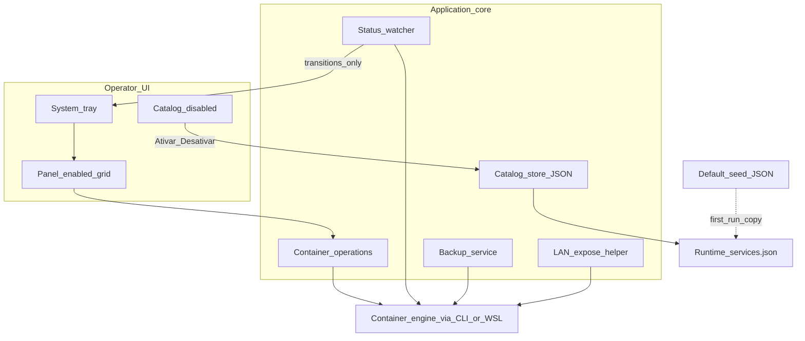

# Requirements: Z-Lab (V1)

**Status:** Draft for QA / implementation alignment  
**Authority:** Functional and behavioral contract is defined by [`docs/SPEC-ZLAB.md`](../docs/SPEC-ZLAB.md) **v0.5**. This document expands that contract into testable requirements.  
**Config schema seed:** [`config/services.default.json`](../config/services.default.json)  
**Runtime config:** `%AppData%\ZLab\services.json` (seeded from default on first run)  
**Language of UI:** Portuguese (Brazil)

> Do not contradict SPEC-ZLAB. If this file and the SPEC diverge, the SPEC wins until both are updated together.

---

## 1. Vision & Scope

### 1.1 Goals

1. Give a local lab operator a **tray + panel** desktop app (**Z-Lab**) to operate, observe, notify, expose on LAN, and back up **Docker-backed lab items** running under WSL2.
2. Drive all items from a **JSON catalog of ServiceItems** (no hardcoded two-panel logic): defaults enable **9router** and **omniroute**; remaining catalog templates stay **visible but disabled** until activated via UI or file.
3. Per **enabled** item: start, stop, restart, status, stats, logs, update, open URL (when configured), backup (when allowed), and LAN expose (when flagged).
4. Notify only on **state transitions** for items that are both **managed** and **enabled**.
5. On explicit Exit: stop all managed+enabled items and **close the process only if every stop succeeds**.

### 1.2 In scope (V1)

| Area | Included |
|------|----------|
| Catalog | ServiceItem list from JSON; activate/deactivate; reload without app restart |
| Control | Start / stop / restart / update for enabled items |
| Observability | Status poll, stats when Up, logs tail |
| UX | Tray residency, panel grid, PT-BR copy, product name/icon |
| Backup | Volume-copy style backup when `backup.mode != none`; folder picker; backup-all eligible |
| LAN | Per-item expose helper when `exposeLan` is true |
| Lifecycle | Ordered exit with confirmation; window close ≠ exit |

### 1.3 Out of scope (V1)

Explicitly deferred (must not be required for V1 acceptance):

- HTTP/TCP health probes beyond container/engine state (`health.type` reserved for later)
- Engine-specific dump backups (e.g. database dump tools)
- Visual env/ports editor or create-service wizard
- Autostart with the host OS
- Multi-service compose orchestration
- Destructive engine cleanup (prune / delete volumes) offered by the app

### 1.4 Personas

| Persona | Need |
|---------|------|
| Local operator | Day-to-day control of lab containers via tray/panel |
| LAN consumer | Uses exposed services; does not use Z-Lab |

### 1.5 References

| Artefact | Role |
|----------|------|
| [`docs/SPEC-ZLAB.md`](../docs/SPEC-ZLAB.md) | Authoritative product contract (v0.5) |
| [`config/services.default.json`](../config/services.default.json) | Default `version` / `settings` / `services[]` seed and field values |
| Runtime `%AppData%\ZLab\services.json` | Operator-editable catalog after first launch |

---

## 2. Functional Requirements

Requirements are numbered for traceability. Priority: **Must** / **Should** / **Could (V2+)**.

### 2.1 Catalog & configuration

| ID | Requirement | Priority |
|----|-------------|----------|
| FR-CAT-01 | The system shall load a versioned JSON document containing `settings` and a list of `ServiceItem` records (schema as defined in SPEC §5 and exemplified by `services.default.json`). | Must |
| FR-CAT-02 | On first run, if the runtime config file does not exist, the system shall create it by copying the default seed. | Must |
| FR-CAT-03 | Default seed shall have `enabled: true` only for ids `9router` and `omniroute`; all other catalog items shall be `enabled: false`. | Must |
| FR-CAT-04 | Disabled items shall remain **visible** in a catalog section with a clear “Desativado” affordance. | Must |
| FR-CAT-05 | The operator shall be able to **Ativar** / **Desativar** an item from the UI; the change shall persist `enabled` in the runtime JSON and refresh the UI. | Must |
| FR-CAT-06 | The operator shall be able to change `enabled` (and other fields) by editing the runtime JSON; a **Recarregar** action shall refresh the UI without restarting the process. | Should |
| FR-CAT-07 | The system shall provide a way to open the runtime config folder (`%AppData%\ZLab`). | Should |
| FR-CAT-08 | Items with `enabled: false` shall not expose operational actions (start/stop/restart/update/stats/logs/backup/expose); only activation (and notes) as applicable. | Must |

### 2.2 Per-item operations (enabled only)

| ID | Requirement | Priority |
|----|-------------|----------|
| FR-OPS-01 | For each enabled item: **Iniciar** — if the container does not exist, create/run from template fields; if it exists, start it. | Must |
| FR-OPS-02 | **Parar** — stop using the item’s `stopTimeoutSeconds` (no confirmation). | Must |
| FR-OPS-03 | **Reiniciar** — restart the container. | Must |
| FR-OPS-04 | **Status** — show container/engine state for the item. | Must |
| FR-OPS-05 | **Stats** — show live resource stats when the container is Up. | Must |
| FR-OPS-06 | **Logs** — show a configurable tail (`settings.logTailLines`). | Must |
| FR-OPS-07 | **Atualizar** — after confirmation: pull image and recreate preserving mounts/volumes as defined for the item. | Must |
| FR-OPS-08 | **Abrir** — if `openUrl` is non-empty, open that URL; if empty, hide the action. | Must |
| FR-OPS-09 | Container engine access shall work via the host Docker CLI when available, or via WSL Docker invocation as fallback (SPEC RF14). | Must |

### 2.3 Status polling & notifications

| ID | Requirement | Priority |
|----|-------------|----------|
| FR-POLL-01 | The system shall poll item status every `settings.pollSeconds` seconds (default 8 in seed). | Must |
| FR-NOT-01 | Notifications (down / up / update result / backup result) shall apply only to items where `managed == true` **and** `enabled == true`. | Must |
| FR-NOT-02 | Notifications shall fire only on **state transitions**, not on every poll while state is unchanged. | Must |
| FR-NOT-03 | The first poll after start shall establish a silent baseline (no flood of notifications). | Must |

### 2.4 Backup

| ID | Requirement | Priority |
|----|-------------|----------|
| FR-BKP-01 | Backup shall be offered for an item only when `backup.mode != none`. | Must |
| FR-BKP-02 | Backup target folder shall come from `settings.backupFolder`; if empty, the operator shall choose a folder before backup proceeds. | Must |
| FR-BKP-03 | Each backup shall write under a stamped subdirectory `{id}_{yyyy-MM-dd_HHmm}` and must **not** delete the source volume. | Must |
| FR-BKP-04 | Backup shall attempt while running (“hot”); if that fails, the system may offer Stop → Backup → Start. | Must |
| FR-BKP-05 | There shall be a “backup all eligible” action for items that qualify under FR-BKP-01. | Must |
| FR-BKP-06 | The UI shall warn that backups may contain secrets/keys. | Must |

### 2.5 LAN expose

| ID | Requirement | Priority |
|----|-------------|----------|
| FR-LAN-01 | When `exposeLan` is true for an item, the system shall offer an expose-on-LAN helper (host port proxy / firewall rule naming per item fields). | Should |
| FR-LAN-02 | Expose actions that require elevated privileges shall request/indicate Admin elevation rather than failing silently. | Should |

### 2.6 Application lifecycle & shell UX

| ID | Requirement | Priority |
|----|-------------|----------|
| FR-UX-01 | Product display name shall be **Z-Lab**; custom product icon shall be used (asset referenced by SPEC). | Must |
| FR-UX-02 | On start, the app shall reside in the system tray; double-click opens the panel. Closing the panel returns to tray (does not exit). | Must |
| FR-UX-03 | Explicit **Sair** shall confirm with copy covering managed stop + “app will not close if a stop fails”. | Must |
| FR-UX-04 | On confirmed Exit: stop every `managed && enabled` item; treat already absent/exited as success; **do not terminate the process** if any stop fails (show error). | Must |
| FR-UX-05 | On successful Exit: remove tray icon and end the process. | Must |
| FR-UX-06 | UI language and operator-facing microcopy shall be PT-BR (SPEC §7.3 patterns). | Must |
| FR-UX-07 | Enabled services and disabled catalog shall be visually distinct; layout shall scale to N items (grid/flow), not a fixed two-column product model. | Must |
| FR-UX-08 | Tray menu shall expose per-enabled-item actions and Exit; optional quick-activate entries are allowed. | Should |

### 2.7 Explicitly not required in V1

| ID | Requirement | Priority |
|----|-------------|----------|
| FR-OUT-01 | HTTP/TCP health checks beyond engine/container state. | Could (V2) |
| FR-OUT-02 | Database engine dump backup modes. | Could (V2) |
| FR-OUT-03 | In-app visual editor for env/ports or create-service wizard. | Could (V2) |
| FR-OUT-04 | Autostart with Windows. | Out of V1 |
| FR-OUT-05 | Compose multi-service stacks as first-class units. | Out of V1 |
| FR-OUT-06 | Offering engine prune or volume deletion. | Forbidden in V1 |

---

## 3. Non-Functional Requirements

| ID | Category | Requirement | Measurable target |
|----|----------|-------------|-------------------|
| NFR-01 | Platform | Desktop operator app for Windows host controlling containers in WSL2 lab environment described in SPEC §1.1. | Runs on the documented operator environment; publishable as a self-contained Windows x64 desktop binary per SPEC RNF01–02. |
| NFR-02 | Localization | All primary operator strings in PT-BR. | Spot-check of main panel, tray Exit, activate, update confirm, backup warning — no English-only operator paths in V1 UI. |
| NFR-03 | Responsiveness | Long container operations must not freeze the UI thread. | Operator can still interact with tray/panel chrome during pull/stop/backup; progress or disabling of the busy action is visible. |
| NFR-04 | Security / privacy | Do not log secrets; warn that backups may contain keys. | No env secrets written to app logs in normal flows; backup warning shown before/during backup. |
| NFR-05 | Safety | No prune / delete-volume affordances. | QA finds no menu/action offering those destructive engine ops. |
| NFR-06 | Config durability | Runtime catalog survives restart and round-trips enable flags. | After Ativar/Desativar and process restart, `enabled` values match last persisted JSON. |
| NFR-07 | Observability defaults | Poll and log tail use seed settings unless changed. | Default poll interval 8s; default log tail 80 lines (from seed). |

*Implementation stack choices (framework, packaging path) are bound by SPEC §4.2 / §1.1; this requirements file stays outcome-focused and does not redefine them.*

---

## 4. Normal Flows

### 4.1 First launch & seed

1. Operator starts Z-Lab.
2. Runtime `%AppData%\ZLab\services.json` is missing.
3. System copies [`config/services.default.json`](../config/services.default.json) to the runtime path.
4. Tray appears; panel (when opened) shows **9Router** and **OmniRoute** in the active area and the remaining templates under Catálogo (Desativado).

### 4.2 Operate an enabled service

1. Operator opens the panel (or uses tray submenu).
2. Selects an enabled item (e.g. 9Router).
3. Chooses Iniciar → container runs or starts.
4. Status poll updates to Up; stats available; logs show recent lines.
5. Operator may Abrir URL when configured, Atualizar (with confirm), Parar, Reiniciar.

### 4.3 Activate a catalog item

1. Operator finds e.g. PostgreSQL under Catálogo with badge Desativado.
2. Chooses Ativar.
3. System sets `enabled: true` in runtime JSON and moves the item to the active services area with control actions.
4. Microcopy informs that Iniciar creates/starts the container if needed.

### 4.4 Deactivate an active item

1. Operator chooses Desativar on an enabled item (e.g. OmniRoute).
2. System sets `enabled: false`, persists JSON, removes operational actions, shows item in catalog as Desativado.

### 4.5 Reload after manual JSON edit

1. Operator edits runtime JSON (enable/disable or field changes).
2. Chooses Recarregar in the panel.
3. UI reflects the file without process restart.

### 4.6 Backup eligible item / all eligible

1. Operator ensures `backupFolder` is set (or picks a folder).
2. Chooses Backup on an item with `backup.mode != none`, or Backup-all eligible.
3. System creates stamped folder artifact; volume data is not deleted; secrets warning is shown.

### 4.7 Exit with clean stop

1. Operator chooses Sair.
2. Confirms the stop-and-exit dialog.
3. System stops all `managed && enabled` items.
4. All stops succeed (or already stopped/absent) → process exits and tray icon is removed.

### 4.8 Notification on transition

1. For a managed+enabled item that was Up, container becomes Down (detected on poll).
2. System raises a single “caiu” notification.
3. Subsequent polls while still Down do not repeat the same notification.

---

## 5. Alternate / Exception Flows

### 5.1 Stop fails during Exit

1. Operator confirms Sair.
2. At least one managed+enabled stop fails.
3. System shows an error; **process remains running**; tray stays.

### 5.2 Hot backup fails

1. Operator starts backup while container is Up.
2. Hot copy fails.
3. System offers optional Stop → Backup → Start path; operator may cancel and remain unchanged.

### 5.3 Update cancelled

1. Operator chooses Atualizar.
2. Declines confirmation.
3. No pull/recreate occurs; prior container state unchanged.

### 5.4 Docker CLI unavailable on host path

1. Host `docker` CLI is not usable.
2. System uses WSL Docker invocation instead (or reports clear unavailability if neither works).
3. Panel indicates active Docker access mode when known.

### 5.5 Open URL not configured

1. Item has empty `openUrl`.
2. Abrir action is hidden; no error spam.

### 5.6 Backup mode none

1. Item has `backup.mode == none`.
2. Backup action is not offered for that item; item is excluded from backup-all eligible set.

### 5.7 Expose LAN without elevation

1. Operator requests expose for an `exposeLan` item.
2. Required host network/firewall change needs elevation.
3. System prompts for Admin / helper rather than silently no-op.

### 5.8 Window close vs Exit

1. Operator closes the panel window.
2. App returns to tray; containers are **not** stopped by that action alone.

---

## 6. Acceptance Criteria (QA-assertable)

Each criterion is pass/fail. Source mapping: SPEC §9 + FR/NFR above.

| AC | Assertion |
|----|-----------|
| AC-01 | Launched app title/branding shows **Z-Lab** and uses the custom product icon (not the generic OS default for untitled apps). |
| AC-02 | First-run creates `%AppData%\ZLab\services.json` from the default seed; file contains `9router` and `omniroute` with `enabled: true` and catalog templates with `enabled: false`. |
| AC-03 | Only enabled items show operational controls (start/stop/restart/status/stats/logs/update and conditional open/backup/expose). |
| AC-04 | Ativar on a disabled catalog item (e.g. postgres) writes `enabled: true` to runtime JSON and places the item in the active area with controls. |
| AC-05 | Desativar on an enabled item writes `enabled: false`, removes operational controls, and shows Desativado in catalog. |
| AC-06 | Manual JSON edit + Recarregar updates the UI without restarting the process. |
| AC-07 | For an existing enabled container: Status, Stats (when Up), Logs, and Atualizar (after confirm) complete successfully against the live engine. |
| AC-08 | Sair stops all managed+enabled items; if any stop fails, the process remains open with an error; if all succeed, the process ends. |
| AC-09 | Notifications for managed+enabled items fire only on transitions; first poll after start does not spam. |
| AC-10 | Backup for `volumeCopy` creates a stamped folder under the configured backup path and does not delete the Docker volume. |
| AC-11 | Closing the panel leaves the app in the tray; containers are not stopped solely by closing the panel. |
| AC-12 | Parar does not require confirmation; Atualizar and Sair do. |
| AC-13 | UI strings for primary paths are PT-BR (activate, deactivate, exit confirm, disabled badge). |
| AC-14 | V1 build/UI does not require or expose HTTP/TCP health probes, pgDump-style backup, visual env editor, OS autostart, or compose as V1 features. |
| AC-15 | No user-facing action offers `docker system prune` or volume deletion. |

---

## 7. High-Level Architecture (conceptual)

Technology-agnostic component view; packaging details remain in the SPEC.

### Key data flows

1. **Config:** Seed → runtime JSON → Store → UI sections (enabled vs catalog).
2. **Control:** UI action → Ops → container engine → status reflected by Watch.
3. **Notify:** Watch detects transition for managed+enabled → tray notification.
4. **Exit:** Confirm → Ops stop-all managed+enabled → exit process iff all OK.

---

## 8. Assumptions & Constraints

1. Operator environment matches SPEC §1.1 inventory (Ubuntu 24.04 WSL2, Docker available in WSL, Windows host for the desktop UI).
2. Container engine is reachable via host Docker CLI **or** WSL Docker; at least one path works for V1 acceptance of ops.
3. ServiceItem field semantics and defaults follow SPEC §5 and [`config/services.default.json`](../config/services.default.json).
4. Advanced template editing in V1 is by editing JSON, not a visual form.
5. Health in V1 is limited to container/engine state (`health.type: docker` in seed).
6. Product naming is **Z-Lab** (not legacy RouterCtrl / Z-ROUTER names).
7. This requirements document must stay aligned with SPEC-ZLAB v0.5; changes to behavior require dual update.

---

## 9. Open Questions

| # | Question | Impact |
|---|----------|--------|
| OQ-01 | Should Recarregar be **Must** instead of Should if operators will edit JSON daily? | Priority of FR-CAT-06 |
| OQ-02 | Exact UX for “backup all eligible” when some items fail mid-batch — abort vs continue? | AC for FR-BKP-05 |
| OQ-03 | Minimum privilege model for LAN expose when Admin is denied (partial success messaging)? | FR-LAN-02 polish |
| OQ-04 | Should tray quick-activate for catalog items be in V1 or deferred? | FR-UX-08 scope |

---

## 10. Traceability

| This doc | SPEC-ZLAB v0.5 |
|----------|----------------|
| §2 Functional | §4.1 RF01–RF19 |
| §3 NFR | §4.2 RNF01–RNF06 |
| §4–5 Flows | §6 Behavior |
| §6 AC | §9 Critérios de aceite |
| Out of scope | §2.3 / RF20–RF21 / Roadmap V2 |

---

## UX / Juice addendum

**SCORE_BEFORE:** 5 / 10  
**SCORE_AFTER:** 8 / 10  

Existing requirements already cover tray residency, PT-BR microcopy seeds, confirmations for Atualizar/Sair, transition-only notifications, and “UI must not freeze.” They under-specify **immediate action → reaction** for the day-to-day ops loop (busy, success, failure, empty, intentional no-op). This addendum tightens interaction quality only — no new product features, no stack choices, no V2 items (HTTP health, visual env editor, modern toast framework, prune).

### Principle

Every meaningful operator action on an **enabled** item (or catalog Ativar / Desativar / Recarregar / Sair / Backup-all) must produce a **visible reaction within one interaction beat**, unless the control is intentionally unavailable (hidden/disabled) and that unavailability is already signalled.

Ambient tray notifications remain **transition-only** for `managed && enabled` (FR-NOT-*). Juice for click-driven ops is primarily **in-panel / tray-menu local feedback**, not notification spam.

### Action → reaction map (V1)

| Operator action | Immediate reaction | Completion reaction | Failure / cancel |
|-----------------|--------------------|---------------------|------------------|
| **Iniciar** | Disable the action on that card; card/status shows working state (e.g. “Iniciando…”); other chrome stays usable (NFR-03). | Status → engine state (Up / created); tray notify only if this is a managed transition from prior known Down/absent baseline (not first silent poll). | Inline/card error in PT-BR; re-enable action; prior container state unchanged when start fails. |
| **Parar** | Same busy pattern (“Parando…”); **no** confirm dialog (AC-12). | Status reflects Stopped/Exited; managed transition may notify “caiu” once. | Error on card; process/tray stay; action re-enabled. |
| **Reiniciar** | Busy (“Reiniciando…”). | Status settles to Up (or reported engine state). | Error + restore actionable controls. |
| **Atualizar** | Confirm dialog first (RF13). On accept: busy (“Atualizando…”); pull/recreate in progress is visible on that item. | Success feedback on card; managed notify ok/fail once. | Decline confirm → **intentional no-op** (no busy, no notify). Fail → error + prior mount-preserving contract unchanged when recreate aborts. |
| **Abrir** | Only when `openUrl` non-empty; otherwise control **hidden** (already intentional no-op — no error spam). | OS opens URL; no modal required. | If open fails, brief PT-BR error on card/status — do not invent alternate navigation. |
| **Logs** | Opening/refreshing logs shows a loading or “atualizando…” cue in the logs area. | Tail of `logTailLines` lines; if empty, empty-state copy (see below). | Engine error → clear PT-BR message in logs area, not a blank silent pane. |
| **Stats** | When Up: show live/ refreshed stats; when not Up: control disabled or inactive with reason (stats only when Up — FR-OPS-05). | Values update with poll/refresh without freezing UI. | Failure → short error; do not show stale numbers as if live without a stale cue. |
| **Backup** (item) | Secrets warning visible before/during (FR-BKP-06); folder picker if `backupFolder` empty; busy (“Backup…”). | Success path/folder acknowledgement; managed notify ok once. | Hot fail → offer Stop→Backup→Start (existing alt flow); cancel leaves state unchanged. |
| **Backup all eligible** | Busy at panel level for the batch; per-item progress or sequential status so the operator sees which item is running. | Summary of succeeded / failed / skipped (`mode == none` never offered). Mid-batch: **continue remaining items** and report failures in the summary (closes OQ-02 toward continue-not-abort unless a later SPEC change says otherwise). | Partial failure does not wipe successful artifacts; no volume deletes. |
| **Expor LAN** | If elevation needed: Admin/helper prompt (FR-LAN-02) — never silent no-op. | Success cue that expose is applied / rule named. | Denial or failure → explicit PT-BR message. |
| **Ativar** | Persist + **move** item from Catálogo to active grid with control affordances; show Ativar microcopy (SPEC §7.3). | Card appears enabled with status baseline. | Persist fail → item stays Desativado + error. |
| **Desativar** | Persist + move back to Catálogo with “Desativado” badge; operational actions removed immediately. | Catalog row shows Desativado affordance. | Persist fail → remains enabled + error. |
| **Recarregar** | Brief busy on toolbar (“Recarregando…”). | UI matches runtime JSON; brief success acknowledgement (status line or toolbar). | Parse/load fail → keep previous UI + error (do not blank the panel). |
| **Abrir pasta de config** | Folder opens via OS. | No extra modal. | Failure → short error. |
| **Sair** | Confirm copy per FR-UX-03. On accept: panel/tray show exit-in-progress; stop each `managed && enabled`. | All OK → tray icon removed + process ends. | Any stop fail → **error MessageBox**, process **remains**, tray stays (FR-UX-04) — strongest juice for safety. |
| **Fechar painel** | Returns to tray; **no** stop; no “exiting” chrome (distinguish from Sair). | Tray residency continues; tooltip/status still reflect last known poll. | N/A |

### Busy exclusivity & chrome

- **Per-item busy** and **modal confirm** are exclusive with that item’s conflicting actions: while Iniciar/Parar/Reiniciar/Atualizar/Backup runs on an item, disable those same mutating actions on **that** item; reading Status/Logs may remain available when safe.
- **Exit-in-progress** is exclusive with starting new mutating ops; operator still sees progress/errors.
- Do **not** stack a second confirm on top of an in-flight busy state for the same action.
- Long Docker work must keep tray/panel chrome responsive (NFR-03): progress **or** disabled busy action is always visible — never a frozen-looking panel with no cue.

### Empty, error, and intentional no-op states

| State | Required reaction |
|-------|-------------------|
| No enabled services (all catalog disabled) | Active area empty-state in PT-BR pointing operator to Catálogo → Ativar (not a blank grid). |
| Enabled but container absent | Status communicates absent/not created; Iniciar remains the primary affordance. |
| Logs empty / no output yet | Explicit empty copy (e.g. sem linhas ainda), not a dead white box. |
| Docker CLI and WSL Docker both unavailable | Panel shows clear unavailability (and mode when known — §5.4); mutating actions fail with the same clear reason. |
| `openUrl` empty / `backup.mode == none` / `exposeLan == false` | Hide or omit those actions (intentional no-op already signalled by absence). |
| Disabled catalog item | Only Ativar (+ notes); hovering/focusing operational ghosts must not appear clickable. |
| First poll after start | Silent baseline — **no** flood (FR-NOT-03); juice comes from panel status painting, not balloons. |

### Tray as ambient juice

- Tray icon remains the “app is alive” signal; double-click opens panel.
- Transition notifications (caiu / subiu / atualizou / backup) are the ambient reaction for unmanaged-looking background change — still **once per transition**.
- Tray submenu mirrors enabled-item actions with the same busy/disable rules as the panel where practical; Exit uses the same confirm + stop contract.

### Delight within product tone

Z-Lab is a **lab operator tool**, not an arcade client. Appropriate juice: crisp status color/text changes, busy labels, confirm/cancel clarity, success path acknowledgement, and trustworthy exit failure blocking. Avoid inventing particle effects, sound packs, or a separate “modern toast” system in V1 (deferred on SPEC roadmap).

### Juice acceptance checks (additive to §6)

| ID | Assertion |
|----|-----------|
| AC-J01 | Starting Iniciar/Parar/Reiniciar/Atualizar/Backup shows per-item busy feedback before completion. |
| AC-J02 | Cancelled Atualizar or Sair confirm leaves state unchanged and shows no false success. |
| AC-J03 | Empty active-services area and empty logs each show PT-BR empty copy. |
| AC-J04 | Hidden Abrir/Backup/Expor when not applicable; no error spam for those absences. |
| AC-J05 | Failed Exit stop keeps process + tray and surfaces an error. |
| AC-J06 | Recarregar acknowledges success or keeps prior UI on failure. |

*End of requirements V1 (incl. UX / Juice addendum).*

