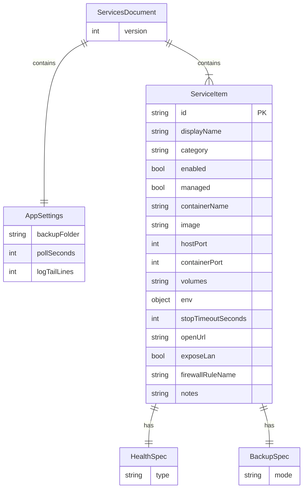

# Technologies: Z-Lab (V1)

**Status:** Approved for implementation alignment  
**Authority:** [`docs/SPEC-ZLAB.md`](../docs/SPEC-ZLAB.md) v0.5 · requirements: [`.docs/requirements.md`](requirements.md)  
**Product:** Z-Lab (`ZLab.exe`) — Windows tray + panel operator for Docker lab items on WSL2  
**Scope of this doc:** stack, layout, hosting, persistence, scalability, cost/benefit, security, standards — **not** feature implementations.

> If this file and SPEC-ZLAB diverge, SPEC wins until both are updated together.

---

## 1. Technology Stack Decision Record (ADR)

| Decision | Choice | Rationale | Alternatives considered | Lock-in / maintenance |
|----------|--------|-----------|-------------------------|------------------------|
| Runtime / TFM | **.NET 8** (`net8.0-windows`) | Matches SPEC RNF01; LTS; Windows Desktop pack available on operator machine | .NET 9 (newer, shorter support window for lab tooling); .NET Framework 4.8 (legacy, no modern SDK path from WSL) | Stick to 8.x until V2 needs force a bump |
| UI framework | **WinForms** | Tray + panel, low ceremony, PT-BR MessageBox / NotifyIcon fit; SPEC §8 names WinForms types | WPF (heavier XAML for card grid); WinUI 3 (packaging/SDK friction on WSL publish); Electron (wrong weight for local Docker CLI wrapper) | UI stays WinForms for V1; V2 toast polish can stay NotifyIcon or thin overlay |
| Language | **C#** (nullable enabled) | Native to WinForms/.NET; async Task model for RNF04 | F# (team unfamiliarity); C++/CLI (no benefit) | — |
| App identity | **AssemblyName / exe: `ZLab.exe`**; UI title **Z-Lab** | SPEC product rename; icon `z-lab.ico` | Legacy RouterCtrl / Z-ROUTER names | Do not reintroduce old names in artifacts |
| Process model | Single Windows process; tray-resident | RF16: close → tray; explicit Exit | Background Windows Service (overkill; no autostart in V1) | — |
| Docker access | **`DockerCli`** → `docker.exe` **or** `wsl docker` | RF14; operator env has Docker in WSL, not always on Windows PATH | Docker.DotNet SDK (API client) — adds dep + version coupling; named-pipe only | Prefer CLI process spawn; keep DockerCli as sole I/O boundary |
| Config format | **JSON** (`System.Text.Json`) | Human-editable catalog; seed + runtime paths defined | YAML (extra package); SQLite (overkill for ~dozen items) | Schema `version: 1`; bump intentionally |
| Persistence | File under `%AppData%\ZLab\services.json` | NFR-06; no server | Registry, cloud sync | AppData only in V1 |
| Publish RID | **`win-x64`** self-contained or framework-dependent Desktop | RNF01–02; run on Windows | `win-arm64` (out of current inventory) | Publish from **WSL SDK 8.0.425** |
| Build host SDK | WSL: **`/home/hill/.dotnet`** SDK **8.0.425** | Windows has Desktop runtime, not SDK on PATH (SPEC §1.1) | Install SDK on Windows (optional later) | Document `export PATH="$HOME/.dotnet:$PATH"` |
| Notify | WinForms `NotifyIcon` + balloon / MessageBox | Transition-only (RF09–10); YAGNI | toast NuGet, Windows App SDK notifications | V2 may polish; V1 stays OS tray |
| LAN expose | **`LanExposeHelper`** → `netsh` portproxy + firewall rule (Admin / script) | RF17 Should; matches operator inventory | Third-party tunnel (ngrok etc.) — cost + cloud dependency | Privileged ops stay opt-in per item `exposeLan` |
| Backup | **`BackupService`** + `docker cp` / volume copy → stamped folder | RF11; mode `volumeCopy` \| `none` | Engine dumps (pg_dump) — V2 | No prune / volume delete (RNF06) |
| Tests | **xUnit** (+ optional FluentAssertions) | Lightweight; runs on WSL SDK | NUnit/MSTest (equivalent); UI automation (defer) | Prefer unit tests of Store/CLI parsing; thin integration with docker mocked |
| Lint / format | **`dotnet format`** + nullable + treat warnings as errors in CI | Low friction for small WinForms app | StyleCop full ruleset (noise); Roslynator packs (YAGNI until needed) | Keep analyzer set small |
| CI expectation | **lint → test → build** (publish optional on tags) | Simple pipeline for desktop tool | Multi-stage containers, CodeQL gates (overkill for V1 private lab) | See §9 |

### Explicit non-choices (YAGNI for V1)

- No DI container framework (manual composition in `Program.cs` / tray bootstrap is enough).
- No ORM / database.
- No REST/gRPC server inside Z-Lab (operator UI only).
- No Compose multi-service orchestration library.
- No Electron / web UI shell.
- No paid SaaS (auth, telemetry, crash reporting) for V1.

---

## 2. Folder layout

Aligned with SPEC §8. Top-level repo layout:

```text
router-ctrl/                          # workspace / project root
├── .docs/                            # team pipeline artefacts (this file, requirements)
├── docs/                             # product contract (SPEC-ZLAB.md)
├── config/
│   └── services.default.json         # seed catalog (embedded / copied on first run)
├── assets/
│   └── z-lab.ico                     # brand asset (repo-level copy)
├── src/
│   └── ZLab/                         # sole V1 application project
│       ├── ZLab.csproj               # net8.0-windows; WinForms; AssemblyName ZLab
│       ├── Program.cs                # entry; first-run seed; composition root
│       ├── TrayApp.cs                # NotifyIcon lifecycle; Exit flow
│       ├── MainForm.cs               # panel: enabled cards + catalog + logs
│       ├── Assets/
│       │   └── z-lab.ico
│       ├── Models/
│       │   ├── ServiceItem.cs
│       │   ├── AppSettings.cs
│       │   └── ServicesDocument.cs   # version + settings + services[]
│       └── Services/
│           ├── DockerCli.cs          # resolve docker.exe | wsl docker; run args
│           ├── ContainerService.cs   # start/stop/restart/update/stats/logs/run
│           ├── ServiceCatalogStore.cs# read/write JSON; Ativar/Desativar; reload
│           ├── StatusWatcher.cs      # poll + transition notifications
│           ├── BackupService.cs      # volumeCopy → stamped folders
│           └── LanExposeHelper.cs    # portproxy / firewall when exposeLan
├── tests/
│   └── ZLab.Tests/                   # xUnit; mocks around DockerCli
├── scripts/                          # optional: publish.sh, run-from-wsl notes
└── .gitignore
```

| Path | Role |
|------|------|
| `src/ZLab` | Only shippable binary (`ZLab.exe`) |
| `config/services.default.json` | Immutable-in-repo seed; copied to AppData on first run |
| `tests/ZLab.Tests` | Unit/contract tests; no requirement for live Docker in default CI |
| `.docs/` | Architecture / requirements for team pipeline |
| `docs/` | Authoritative product SPEC |

**Solution file:** prefer `ZLab.sln` at repo root referencing `src/ZLab` and `tests/ZLab.Tests` (create at implementation time).

---

## 3. Hosting & runtime topology

```text
┌─ Windows host ─────────────────────────────────────────┐
│  ZLab.exe (tray + panel)                               │
│    ├─ ServiceCatalogStore → %AppData%\ZLab\services.json│
│    ├─ DockerCli ──┬─ docker.exe (if present)           │
│    │              └─ wsl -d Ubuntu-24.04 docker …      │
│    ├─ LanExposeHelper → netsh portproxy + firewall     │
│    └─ BackupService → settings.backupFolder            │
└────────────────────────────┬───────────────────────────┘
                             │ WSL2
┌─ Ubuntu-24.04 ─────────────▼───────────────────────────┐
│  Docker Engine 29.x  ·  containers (9router, …)        │
└────────────────────────────────────────────────────────┘
```

| Concern | Decision |
|---------|----------|
| Where it runs | **Windows** desktop process |
| Where containers run | **WSL2** Docker (operator inventory) |
| Where it is built | **WSL** with SDK **8.0.425**; output RID **`win-x64`** |
| Distribution | Local publish / copy of `ZLab.exe` (+ deps if framework-dependent); no store / installer required for V1 |
| Autostart | **Out of V1** (SPEC decision §11.6) |
| Cloud hosting | **None** — single-user local lab |

### Publish (reference)

```bash
# WSL
export PATH="$HOME/.dotnet:$PATH"
cd /mnt/c/GIT/ZAPFCOORP/router-ctrl
dotnet publish src/ZLab/ZLab.csproj -c Release -r win-x64 --self-contained false
# or --self-contained true when target PCs lack Desktop runtime
```

**Framework-dependent** preferred when operator already has .NET 8 Desktop Runtime (SPEC §1.1). **Self-contained** optional for machines without the runtime — flag the larger artifact as a maintenance trade-off.

---

## 4. Persistence & data model

### 4.1 Strategy

| Store | Path | Writer | Notes |
|-------|------|--------|-------|
| Seed | `config/services.default.json` (repo; may be Content copy to output) | Humans / SE only | Never mutated by the running app |
| Runtime | `%AppData%\ZLab\services.json` | `ServiceCatalogStore` | Created by copy on first run; Ativar/Desativar/settings edits |
| Backups | `settings.backupFolder` / `{id}_{yyyy-MM-dd_HHmm}\` | `BackupService` | May contain secrets — warn in UI (RNF05) |
| Secrets | Prefer empty/`CHANGE_ME` in seed; operator edits runtime JSON | Operator | **Do not log** `env` values |

No database. Persistence = JSON file I/O + filesystem backup folders.

### 4.2 Document schema (logical)

```json
{
  "version": 1,
  "settings": {
    "backupFolder": "",
    "pollSeconds": 8,
    "logTailLines": 80
  },
  "services": [ /* ServiceItem */ ]
}
```

### 4.3 Entity relationship



| Field group | V1 rule |
|-------------|---------|
| `enabled` | Gates operational actions; catalog shows disabled items |
| `managed` | Gates Exit stops + transition notifications |
| `health.type` | `"docker"` only in V1; reserve `http`/`tcp` for V2 |
| `backup.mode` | `"volumeCopy"` \| `"none"`; `pgDump` = V2 |

Serialization: **System.Text.Json** with property names matching the seed file (camelCase). Unknown fields: prefer tolerate-on-read for forward compatibility within `version: 1`.

---

## 5. API exposure

Z-Lab is **not** an HTTP API server. “APIs” are local boundaries:

| Boundary | Consumer | Contract |
|----------|----------|----------|
| `DockerCli` | `ContainerService`, `StatusWatcher`, `BackupService` | Process args + stdout/stderr/exit code; mode label `docker` \| `wsl docker` for UI |
| `ServiceCatalogStore` | UI / tray | Load, Save, SetEnabled, Reload; atomic write (temp + replace) recommended |
| `LanExposeHelper` | UI (Admin elevation) | Map `hostPort` → WSL IP via portproxy; named firewall rule |
| Operator URL open | OS default browser | `openUrl` string only |
| LAN consumers | Other devices on LAN | Hit Windows host IP + portproxy’d ports — **not** Z-Lab itself |

### Status codes (process / UX mapping)

| Outcome | Handling |
|---------|----------|
| Docker CLI exit 0 | Success path |
| Non-zero / timeout | Surface PT-BR error on card / MessageBox; do not crash process |
| Stop failure on Exit | **Block** process exit (RF12) |
| Missing runtime JSON | Seed copy (first run) |
| Invalid JSON on reload | Keep last good in-memory model; show error |

No OpenAPI surface for V1.

---

## 6. Scalability

| Dimension | V1 expectation | Approach |
|-----------|----------------|----------|
| Service count | ~10–30 catalog items | In-memory list + card flow layout; JSON load is trivial |
| Poll load | One poll cycle / `pollSeconds` (default 8s) | `StatusWatcher` batches or sequential CLI calls; avoid parallel stampede |
| Concurrent ops | Operator-driven, one heavy op per item at a time | Disable busy action; async off UI thread (NFR-03) |
| Multi-user / multi-machine | Out of scope | Single operator, single AppData profile |
| Horizontal scale | N/A | Desktop tool |

**Do not** introduce message buses, background job servers, or shared DB for V1 catalog size.

---

## 7. Cost–benefit of services / dependencies

| Component / service | Cost | Benefit | V1 verdict |
|---------------------|------|---------|------------|
| WinForms + .NET 8 Desktop | Free; runtime often already installed | Fast tray UX; matches SPEC | **Use** |
| Docker CLI via process | Free; already in lab | Zero SDK lock-in to Engine API | **Use** (`DockerCli`) |
| Docker.DotNet / Engine API client | Package + API version churn | Typed API | **Defer** unless CLI parsing becomes fragile |
| System.Text.Json | In-box | Seed fidelity | **Use** |
| DI container (MS.Extensions.DependencyInjection) | Extra ceremony | Testability | **Optional / lean** — manual ctor wiring preferred unless tests demand it |
| Serilog / heavy logging stacks | Config surface | Diagnostics | **Avoid**; minimal `Debug`/`Trace` or small file logger without secrets |
| Crash analytics / SaaS | Privacy + cost | Telemetry | **No** |
| Auto-updater service | Complexity | Convenience | **No** (manual republish) |
| Installer (MSI/ClickOnce) | Maintenance | One-click install | **Defer**; publish folder is enough |
| WSL `netsh` portproxy helper | Needs Admin | LAN access (RF17) | **Should** — `LanExposeHelper` only when `exposeLan` |
| Compose / Portainer embedding | Scope creep | Multi-service UX | **Out** (catalog item may point at Portainer image as disabled template only) |

---

## 8. Security checklist

| Area | Standard |
|------|----------|
| Authentication | None in-app (local trusted operator). LAN expose is network exposure of **containers**, not of Z-Lab auth. |
| Authorization | Elevation only for `LanExposeHelper` (UAC / Admin script). Normal docker ops rely on WSL docker group. |
| Secrets | Do not write `env` secret values to logs or notifications. Seed uses placeholders (`CHANGE_ME`). Backup UI must warn (RNF05). |
| Destructive ops | **Forbidden** in UI: `docker system prune`, delete volumes (RNF06 / FR-OUT-06). |
| Input validation | Validate ports, ids, paths; sanitize arguments passed to CLI (no raw string concat of untrusted multi-arg blobs). Prefer argv arrays. |
| Config integrity | Atomic save of `services.json`; tolerate corrupt file with clear PT-BR error. |
| Dependencies | Prefer BCL; add NuGet only with clear need (YAGNI). Pin versions in `csproj`. Review transitive packages on add. |
| Backup data | Treat backup folders as sensitive; no upload feature in V1. |
| Network | Default bind is Docker/WSL concern; Z-Lab only adds portproxy when operator enables `exposeLan`. |

---

## 9. Coding standards & quality gates

### 9.1 Language / project

| Rule | Value |
|------|-------|
| TFM | `net8.0-windows` |
| UI | `<UseWindowsForms>true</UseWindowsForms>` |
| Nullable | `enable` |
| Implicit usings | `enable` (acceptable) |
| Async | `async`/`await` for all Docker CLI and file I/O that can block; no sync-over-async on UI thread |
| Naming | Types PascalCase; locals camelCase; private fields `_camelCase` or team-consistent; JSON DTOs match seed names |
| Localization | Operator-visible strings **PT-BR** (RNF03) |
| Comments | Prefer clear names; comment only non-obvious Docker/WSL quirks |

### 9.2 Dependency policy (YAGNI)

1. Start with **BCL + WinForms** only.
2. Add a NuGet package only when it removes non-trivial code **and** has no cloud/runtime tax.
3. Reject packages that pull hosting, HTTP servers, or telemetry by default.
4. Test helpers (xUnit, Moq/NSubstitute, FluentAssertions) allowed in `tests/` only.

### 9.3 Env / config strategy

| Layer | Mechanism |
|-------|-----------|
| Catalog & settings | `%AppData%\ZLab\services.json` (primary) |
| Seed | `config/services.default.json` → copy if runtime missing |
| Build-time | No secrets in `csproj` or source; images/ports in seed are lab defaults |
| Process env | Optional: none required for V1; DockerCli may read `PATH` / WSL distro name constant (`Ubuntu-24.04` per inventory) |
| Feature flags | Prefer fields on `ServiceItem` / `settings` over external flag services |

**Do not** use `.env` files for the WinForms app in V1 unless SE finds a concrete need; JSON catalog is the operator contract.

### 9.4 Test runner / CI expectation

Order is fixed and intentionally small:

```text
1. lint   →  dotnet format --verify-no-changes  (and/or build with TreatWarningsAsErrors)
2. test   →  dotnet test ZLab.sln -c Release --no-build  (after build)  or  dotnet test
3. build  →  dotnet build / dotnet publish -r win-x64
```

| Gate | Command (reference) | Fail when |
|------|---------------------|-----------|
| Lint/format | `dotnet format --verify-no-changes` | Style drift |
| Test | `dotnet test` | Any failing unit test |
| Build | `dotnet build -c Release` | Compile errors/warnings-as-errors |
| Publish (manual/release) | `dotnet publish … -r win-x64` from WSL SDK 8.0.425 | Publish failure |

**CI shape:** single job on Linux agent **or** documented WSL script is enough; Docker-in-CI is **not** required for default unit tests (mock `DockerCli`). Optional nightly/manual check against live Docker on the operator machine.

Avoid: multi-repo release trains, mandatory containerized build for this desktop tool, heavy matrix of UI frameworks.

### 9.5 Module responsibilities (no implementation here)

| Type | Responsibility |
|------|----------------|
| `DockerCli` | Discover invocation mode; run docker commands; return structured text/exit |
| `ContainerService` | Map `ServiceItem` → start/run/stop/restart/update/stats/logs |
| `ServiceCatalogStore` | Load/save/reload JSON; enable/disable persistence |
| `StatusWatcher` | Timer poll; baseline silence; transition notify for managed+enabled |
| `BackupService` | volumeCopy artifacts; hot attempt then stop→backup→start offer |
| `LanExposeHelper` | portproxy + firewall for `exposeLan` items |
| `TrayApp` / `MainForm` | PT-BR UX only; call services asynchronously |

---

## 10. Long-term / lock-in flags

| Decision | Implication |
|----------|-------------|
| WinForms + net8.0-windows | Stays Windows-only; macOS/Linux UI would be a rewrite |
| CLI-based Docker | Coupled to Docker CLI UX/flags; Engine API migration later is localized to `DockerCli` |
| JSON catalog `version: 1` | Schema migrations need explicit bump + loader compatibility |
| AppData path `ZLab` | Renames require migration copy |
| Publish from WSL SDK | Contributors need WSL or a Windows SDK install documented as alternative |

---

## 11. Traceability

| SPEC / NFR | Technology choice |
|------------|-------------------|
| RNF01 WinForms .NET 8 win-x64 | §1 stack, §3 publish |
| RNF02 Publish WSL / run Windows | §3 hosting |
| RNF04 Async UI | §9.1 async rules |
| RNF05–06 secrets / no prune | §8 security |
| RF14 docker \| wsl docker | `DockerCli` |
| §5 services.json paths | §4 persistence |
| §8 architecture types | §2 folder layout |

---

*End of TA artefact. Implementation belongs to Software Engineer stages; tests to QA.*
