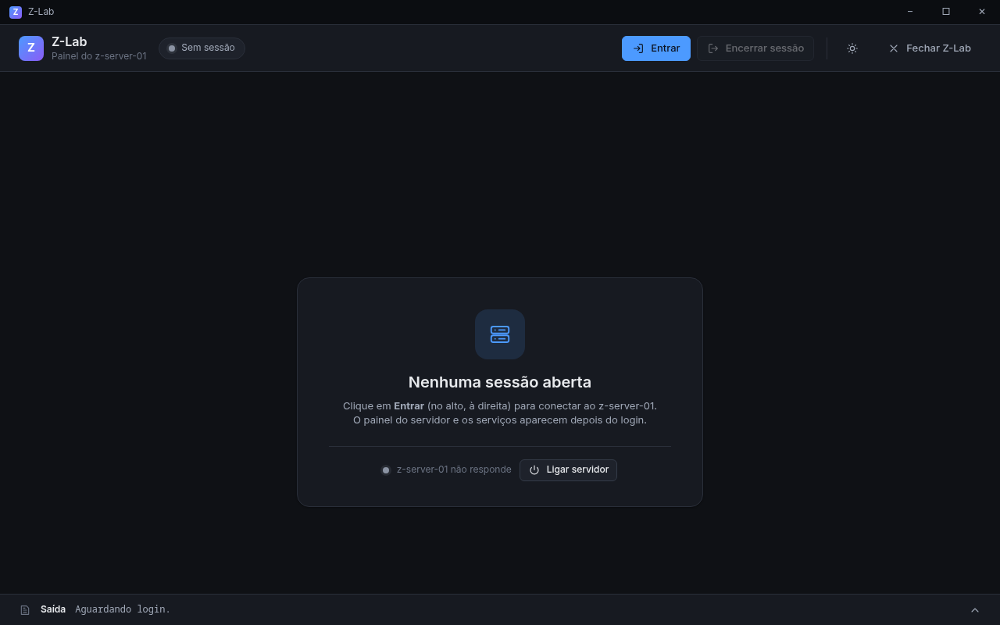
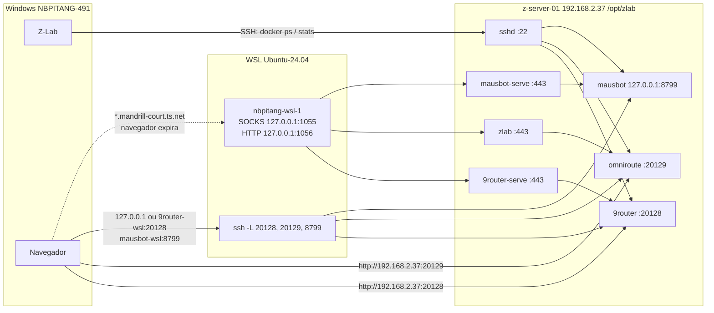

# Z-Lab

App Windows (WinForms .NET 8) que monitora o z-server-01: seis serviços do Compose em `/opt/zlab`, sessão SSH com usuário e senha, Wake-on-LAN.

## Servidor

Este repositório e o [z-server-01](https://github.com/zee-dash-one/z-server-01) (`C:\GIT\ZAPFCOORP\z-server-01`) são um ecossistema. A máquina e o Compose ficam naquele repositório.

**Fonte de verdade** (IP, MAC, rede, hardware, serviços): `C:\GIT\ZAPFCOORP\z-server-01\README.md`. Não inventar IP antigo `192.168.0.x` — desde 19/10/2026 a LAN é `192.168.2.0/24` (`192.168.2.37` o servidor).

O sudoers estreito está em `z-server-01/zlab/sudoers-zlab-monitor` e ainda precisa ser aplicado à mão (`zlab/aplicar-sudoers.sh`).

## O que o Z-Lab faz no z-server-01

A sessão é SSH para `melchior@192.168.2.37:22`. Os comandos saem como `sudo -n` e só os da lista fechada em `RemoteCommands`. O Compose é `/opt/zlab/docker-compose.yml`. O exe não fala com o Docker do WSL.

O pacote mágico de ligar a máquina não usa SSH. Sai em UDP para `192.168.2.255:9`, MAC `FC:AA:14:F9:80:D4`.

### Observa

| Leitura | Comando |
| --- | --- |
| CPU / carga | `uptime`, `/proc/loadavg` |
| Memória | `free -h` |
| Disco do sistema | `df -h /` (`ubuntu-lv`) |
| Disco do Docker | `df -h /var/lib/docker` (`docker-lv`) |
| Disco de dados | `df -h /data` (ainda sem montagem: o painel mostra "Não instalado") |
| Estado do serviço | `docker compose ps -a` |
| Uso do container | `docker stats --no-stream` (CPU, memória, PIDs) |
| Saída | `docker compose logs --tail 80` |

Os seis nomes são `9router`, `omniroute`, `mausbot`, `tailscale`, `tailscale-9router` e `tailscale-mausbot`. Os três Tailscale usam `docker compose --profile tailnet`.

### Muda

| Ação | Efeito no servidor |
| --- | --- |
| Iniciar / Parar | `docker compose start` ou `stop` daquele serviço |
| Atualizar | `pull` e `up -d`. O volume fica. |
| Código de acesso do MausBot | `docker exec mausbot … pair --label Z-Lab`. O código aparece na tela e não é gravado. |
| Desligar | `shutdown -h now`. O SSH cai e os containers param com o sistema. |
| Reiniciar | `reboot`. No boot o Docker sobe e os containers voltam por `restart: unless-stopped`. |

Não edita o Compose, não apaga volume e não mexe em outro projeto Docker do servidor. O túnel `scripts/start-tunnel.sh` e o container Tailscale do WSL são do navegador neste PC, não do monitor.

## Docs

- Produto: [docs/SPEC-ZLAB.md](docs/SPEC-ZLAB.md) (2.0)
- Desenvolvimento: [.docs/](.docs/) (`requirements`, `technologies`, `ui-ux`, `todo`, `tech-debt`, `specs/`)
- Plano: [.docs/plans/zlab-no-z-server-01.md](.docs/plans/zlab-no-z-server-01.md)
- Dúvidas e restos: [.docs/tech-debt.md](.docs/tech-debt.md)

## Build (WSL)

```bash
export PATH="/home/hill/.dotnet:$PATH"
export DOTNET_ROOT="/home/hill/.dotnet"
cd /mnt/c/GIT/ZAPFCOORP/router-ctrl
dotnet test ZLab.sln -c Release
dotnet publish src/ZLab/ZLab.csproj -c Release -r win-x64 --self-contained false -o publish/ZLab
```

## Interface

Tokens e controles em `src/ZLab/Ui/`. Mockups: `docs/mockups/`. Capturas: `docs/screenshots/`.

Redesign (tarefas 01–07) concluído. Tailscale no WSL: `wsl/tailscale-windows/` (SOCKS5 em `127.0.0.1:1055`, tag `winwsl`).



Galeria dos componentes (tema claro/escuro):

```powershell
dotnet run --project src/ZLab -- --galeria
```

Atalhos: `Ctrl+L` mostra/esconde a Saída; `F5` atualiza as métricas (com sessão).

## Run (Windows)

```powershell
.\publish\ZLab\ZLab.exe
```

Requer .NET 8 Desktop Runtime. O exe fala com `192.168.2.37:22`. Não usa `wsl docker`.

A limpeza do Docker no WSL (containers e volumes nomeados, portproxy, hosts) é `scripts/wipe-wsl-docker.ps1`. Ela pede a palavra `APAGAR` e não faz parte da subida do exe.

### Tailscale no WSL (SOCKS5)

Depois da limpeza, um único container userspace (`hostname` `nbpitang-wsl`) publica SOCKS5 **só** em `127.0.0.1:1055`. Detalhes: [`wsl/tailscale-windows/README.md`](wsl/tailscale-windows/README.md).

```powershell
# 1) Copie wsl/tailscale-windows/.env.example → .env e cole TS_AUTHKEY=
# 2) Suba:
wsl -d Ubuntu-24.04 -- bash -lc 'cd /mnt/c/GIT/ZAPFCOORP/router-ctrl/wsl/tailscale-windows && docker compose up -d'
# 3) Prove (não altera o proxy do sistema):
curl.exe --socks5 127.0.0.1:1055 https://zlab.mandrill-court.ts.net
```

O NetExtender em túnel dividido e o WinINET ficam intocados. Não instale o app Tailscale no Windows.

## Rede

A sessão e o Liga usam IPv4 (`192.168.2.37`, broadcast `192.168.2.255`). O pull de imagem acontece no servidor. O script `scripts/fix-wsl-docker-ipv4.sh` continua no repositório para o Docker do WSL, e não é o caminho do botão Atualizar.

O Z-Lab observa os containers por SSH na LAN. Ele não passa pelo Tailscale do WSL. O navegador chega nos painéis por `localhost` (túnel SSH) ou direto na LAN nas portas 20128 e 20129. Os nomes `*.mandrill-court.ts.net` saem pelo proxy do container `nbpitang-wsl-1`; no Chrome, no Brave e no Opera essa ligação expira. O `hosts` só troca o nome por `127.0.0.1` (`9router-wsl:20128`, `mausbot-wsl:8799`). A porta continua na URL.



O túnel sobe com `scripts/start-tunnel.sh`. O `scripts/setup-portproxy.ps1` só cria `portproxy` se o Windows deixar de enxergar o `localhost` do WSL.