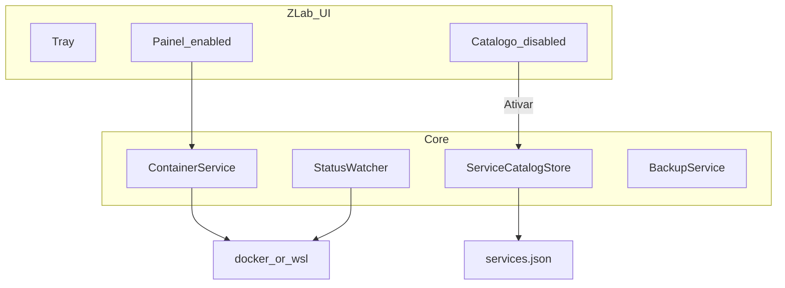

# Spec: Z-Lab

**Versão:** 0.5  
**Data:** 2026-09-28  
**Idioma:** Português (Brasil)  
**Status:** Contrato V1 aprovado para implementação (código C# em fase seguinte)  
**Nome do produto:** **Z-Lab** (`AssemblyName` / exe: `ZLab.exe`; título UI: `Z-Lab`)  
**Documento anterior:** [SPEC-ROUTERCTRL.md](SPEC-ROUTERCTRL.md) (legado; este arquivo é a fonte da verdade de produto)  
**Docs de desenvolvimento (ZTeam):** [`.docs/`](../.docs/) — `requirements.md`, `technologies.md`, `ui-ux.md`, `todo.md`, `specs/*.spec.md`

---

## 1. Resumo

O **Z-Lab** é um aplicativo **Windows** (bandeja + painel) para **operar, observar, notificar, expor na LAN e fazer backup** de **itens Docker** no WSL2, configurados por **arquivo JSON**.

Na V1:

- Tudo é um **ServiceItem** (não há hardcode de “dois painéis” na lógica).
- **Habilitados por padrão:** 9Router e OmniRoute.
- **Catálogo** com templates (databases, APIs, LLMs, mídia, etc.) **visíveis mas desativados**; o usuário **ativa/desativa** pela UI ou editando o JSON.
- Por item enabled: controle, atualização, observabilidade (e backup/abrir URL quando aplicável).

**Marca / ícone:** [`assets/z-lab.ico`](../assets/z-lab.ico) e [`src/ZLab/Assets/z-lab.ico`](../src/ZLab/Assets/z-lab.ico) (mesmo visual Z+9; renomeado do asset anterior).

---

## 1.1 Ambiente do operador (WSL / Windows) — dados reais

> Inventário coletado em **2026-09-28**. O IP do WSL muda após `wsl --shutdown` / reboot — reaplicar portproxy.

### Linux (WSL2)

| Item | Valor |
|------|--------|
| Distro WSL | `Ubuntu-24.04` (default `*`) |
| WSL versão | **2** |
| SO | Ubuntu **24.04.4 LTS** (Noble Numbat) |
| Kernel | `6.6.87.2-microsoft-standard-WSL2` |
| Hostname | `NBPITANG-491` |
| Usuário Linux | `hill` (uid 1000) |
| Home | `/home/hill` |
| Grupos | `sudo`, `docker`, `ollama` |
| Abrir shell | `wsl -d Ubuntu-24.04` |

### Docker

| Item | Valor |
|------|--------|
| Client / Server | **29.8.1** |
| Binário | `/usr/bin/docker` |
| 9Router | `9router` / `decolua/9router:latest` / **20128** |
| OmniRoute | `omniroute` / `diegosouzapw/omniroute:latest` / **20129→20128** |
| Volume 9Router | `9router-data` → `/app/data` |
| Volume OmniRoute | `omniroute-data` |

### .NET

| Onde | Valor |
|------|--------|
| Windows | Runtime .NET **8** Desktop; sem SDK no PATH |
| WSL | SDK **8.0.425** em `/home/hill/.dotnet` |

### Rede

| Item | Valor (2026-09-28) |
|------|---------------------|
| IP Windows (Wi‑Fi) | `192.168.0.106` |
| IP WSL | `172.29.170.210` |
| Portproxy | `20128` e `20129` → IP WSL |
| LAN OmniRoute | `http://192.168.0.106:20129` |
| Sessões browser | Botão **Hosts locais** → `9router-local` / `omniroute-local` (cookies isolados). Fallback sem hosts: `localhost:20128` + `127.0.0.1:20129` |

### Caminhos

| Contexto | Caminho |
|----------|---------|
| Windows repo | `C:\GIT\ZAPFCOORP\router-ctrl` |
| WSL repo | `/mnt/c/GIT/ZAPFCOORP/router-ctrl` |
| App | `src/ZLab` |
| Ícone | `src/ZLab/Assets/z-lab.ico` |
| Config exemplo | `config/services.default.json` |
| Config runtime | `%AppData%\ZLab\services.json` |
| Spec | `docs/SPEC-ZLAB.md` |

### Comandos úteis

```bash
wsl -d Ubuntu-24.04
cd /mnt/c/GIT/ZAPFCOORP/router-ctrl
docker ps --format 'table {{.Names}}\t{{.Status}}\t{{.Ports}}'
export PATH="$HOME/.dotnet:$PATH"
```

```powershell
wsl hostname -I
netsh interface portproxy show all
```

---

## 2. Contexto e problema

### 2.1 Situação

Lab local com vários containers Docker no WSL (gateways de IA hoje; amanhã DB, API, Ollama, etc.). Operar tudo via terminal e portproxy manual não escala.

### 2.2 Problemas que o Z-Lab resolve

1. Ver status / stats / logs por **item**.
2. Iniciar / parar / reiniciar / atualizar por item.
3. Abrir URL (dashboard/API docs) quando configurado.
4. Backup de dados (quando o template permitir).
5. Notificar queda / subida / fim de atualização.
6. Expor portas na LAN (flag por item).
7. **Ativar** novos serviços do catálogo (UI ou arquivo) sem recompilar.
8. Sair com **stop ordenado** de todos os itens `managed`+`enabled`.

### 2.3 O que a V1 NÃO é

- Portainer completo / editor visual de env/ports (edição avançada = JSON).
- Health HTTP/TCP além do estado Docker (campo reservado para V2).
- `pg_dump` e backups por engine (V2).
- Autostart com Windows.
- Compose multi-serviço.

---

## 3. Personas

| Persona | Objetivo |
|---------|----------|
| Operador local | Gerenciar o lab Docker no dia a dia pela bandeja/painel. |
| Usuário LAN | Consome serviços expostos; não usa o Z-Lab. |

---

## 4. Requisitos V1

### 4.1 Funcionais

| ID | Requisito | Prioridade |
|----|-----------|------------|
| RF01 | Modelo **item-based**: lista de `ServiceItem` vindos do JSON | Must |
| RF02 | Defaults **enabled:** `9router`, `omniroute` | Must |
| RF03 | Catálogo de templates **disabled** visível na UI com badge “Desativado” | Must |
| RF04 | **Ativar / Desativar** item pela UI **e** pelo arquivo JSON | Must |
| RF05 | Por item enabled: Iniciar, Parar, Reiniciar, Status, Logs, Atualizar | Must |
| RF06 | Abrir URL se `openUrl` preenchido | Must |
| RF07 | Stats (`docker stats`) quando Up | Must |
| RF08 | Poll de status a cada N s (settings) | Must |
| RF09 | Notificar caiu / subiu / atualizou para itens `managed && enabled` | Must |
| RF10 | Sem spam: só em transição de estado | Must |
| RF11 | Backup por item se `backup.mode != none`; pasta escolhida + “backup de todos elegíveis” | Must |
| RF12 | Sair: stop de todos `managed && enabled`; **não fecha** se algum stop falhar | Must |
| RF13 | Confirmação antes de Atualizar e antes de Sair | Must |
| RF14 | Docker via `docker.exe` ou `wsl docker` | Must |
| RF15 | Nome UI **Z-Lab** + ícone `z-lab.ico` | Must |
| RF16 | Fechar janela → bandeja; Sair explícito para encerrar | Must |
| RF17 | `exposeLan` por item (helper Admin / script) | Should |
| RF18 | Recarregar JSON sem reiniciar o app | Should |
| RF19 | Abrir pasta `%AppData%\ZLab` | Should |
| RF20 | Health `http`/`tcp` e `pgDump` | Could (V2) |
| RF21 | Wizard criar serviço / editar env na UI | Could (V2) |

### 4.2 Não funcionais

| ID | Requisito |
|----|-----------|
| RNF01 | .NET 8 WinForms, `win-x64` |
| RNF02 | Publish no WSL; run no Windows |
| RNF03 | UI PT-BR |
| RNF04 | Async; UI não trava em docker longo |
| RNF05 | Não logar secrets; avisar que backup pode conter chaves |
| RNF06 | Não oferecer `docker system prune` / apagar volumes |

---

## 5. Modelo de serviços (`services.json`)

### 5.1 Localização

| Arquivo | Uso |
|---------|-----|
| [`config/services.default.json`](../config/services.default.json) | Embarcado / copiado na 1ª execução |
| `%AppData%\ZLab\services.json` | Runtime (usuário) |

Na primeira execução: se não existir runtime, copiar o default.

### 5.2 Schema

```json
{
  "version": 1,
  "settings": {
    "backupFolder": "",
    "pollSeconds": 8,
    "logTailLines": 80,
    "backupDailyEnabled": true,
    "backupDailyTime": "03:00",
    "lastAutoBackupDate": ""
  },
  "services": [ /* ServiceItem */ ]
}
```

**ServiceItem (campos):**

| Campo | Tipo | Descrição |
|-------|------|-----------|
| `id` | string | Id estável (`9router`, `postgres`, …) |
| `displayName` | string | Nome na UI |
| `category` | string | `gateway` \| `database` \| `api` \| `llm` \| `media` \| `other` |
| `enabled` | bool | Se false → só Ativar (sem operar) |
| `managed` | bool | Entra no Sair + notificações |
| `containerName` | string | Nome Docker |
| `image` | string | Imagem |
| `hostPort` | number | Porta no host |
| `containerPort` | number | Porta no container |
| `volumes` | string[] | Ex.: `"omniroute-data:/app/data"` |
| `env` | object | Variáveis (evitar secrets no default) |
| `stopTimeoutSeconds` | number | Default 10; OmniRoute 40 |
| `openUrl` | string | URL ao clicar Abrir (vazio = ocultar) |
| `localHost` | string | Alias opcional no hosts Windows (ex.: `9router-local`); botão **Hosts locais** grava `127.0.0.1` + atualiza `openUrl` |
| `health` | object | V1: `{ "type": "docker" }`; V2: `http`/`tcp` |
| `backup` | object | `{ "mode": "volumeCopy" \| "none" }` |
| `exposeLan` | bool | Portproxy/firewall |
| `firewallRuleName` | string | Nome da regra Windows |
| `notes` | string | Texto UI / Em breve |

### 5.3 Defaults enabled

| id | container | host:container | managed | backup |
|----|-----------|----------------|---------|--------|
| `9router` | `9router` | 20128:20128 | true | volumeCopy |
| `omniroute` | `omniroute` | 20129:20128 | true | volumeCopy |

### 5.4 Catálogo disabled (visível)

- **database:** postgres, mysql, redis, mongodb  
- **api:** n8n, generic-api  
- **llm:** ollama  
- **media:** comfyui (imagem), whisper (áudio STT), piper-tts (áudio TTS)  
- **other:** portainer  

Ativar na V1: grava `enabled: true` no JSON. **Iniciar:** se container não existe, `docker run` com template; se existe, `docker start`.

---

## 6. Comportamento

### 6.1 Ciclo de vida

```text
Start ZLab.exe
  → carrega %AppData%\ZLab\services.json (ou copia default)
  → bandeja + poll
  → UI: cards enabled + seção Catálogo (disabled)
  → Ativar/Desativar → grava JSON + atualiza UI
  → Sair → confirma → stop all managed+enabled → só fecha se todos OK
```

### 6.2 Ações por item enabled

| Ação | Comportamento |
|------|----------------|
| Iniciar | `start` ou `run` conforme existência |
| Parar | `stop -t timeout` |
| Reiniciar | `restart` |
| Status / Stats / Logs | docker inspect / stats / logs |
| Atualizar | confirma → pull → recreate preservando mounts |
| Abrir | `openUrl` |
| Hosts locais | (toolbar) grava aliases `localHost` no hosts Windows + atualiza `openUrl` |
| Backup | se mode ≠ none; pasta settings |
| Expor LAN | se exposeLan (Admin) |
| Ativar / Desativar | só muda `enabled` + persist |

### 6.3 Notificações

Só `managed && enabled`. Eventos: caiu, subiu, atualizou (ok/falha), backup ok/falha. Baseline silencioso no 1º poll.

### 6.4 Sair

1. Confirmar (“Parar N serviços gerenciados e sair?”).  
2. Stop em cada `managed && enabled`.  
3. Ausente/Exited = OK.  
4. Se algum falhar → **não fecha**; MessageBox.  
5. Senão → Exit + remove ícone.

### 6.5 Backup

- Pasta em `settings.backupFolder` (FolderBrowser se vazio).  
- **Manual:** pasta nova `{id}_{yyyy-MM-dd_HHmm}\` ou `{id}_{nome}` (nome opcional na UI); não sobrescreve o slot auto.  
- **Automático (diário):** enquanto o Z-Lab estiver aberto, 1× por dia em `settings.backupDailyTime` (default `03:00`) para `auto\{id}\` (**sobrescreve**); só `enabled` com `backup.mode == volumeCopy`; quente sem prompt frio; `lastAutoBackupDate` após sucesso do ciclo; pasta vazia → job não roda (aviso discreto).  
- Tenta quente; manual: se falhar, pergunta Parar → Backup → Iniciar.  
- Aviso: pode conter secrets.

---

## 7. UI / UX

### 7.1 Princípios

- Linguagem operacional (Iniciar/Parar/Ativar), não jargão docker puro.  
- Enabled vs Desativado visualmente distintos.  
- Grid/flow de cards (N itens), não só 2 colunas fixas.  
- Mora na bandeja.
- Poll de status atualiza labels **in-place** (sem reconstruir cards) para evitar flicker.

### 7.2 Layout

```text
┌─ Z-Lab ─────────────────── Modo: wsl docker ──────────┐
│ Pasta backup: … [Alterar] [Abrir pasta] [Backup todos] [Config] [Recarregar]│
│ Serviços ativos                                        │
│ ┌─ 9Router ─┐ ┌─ OmniRoute ─┐  …                       │
│ │ Up …      │ │ Up …        │                          │
│ │ [ações]   │ │ [ações]     │                          │
│ └───────────┘ └─────────────┘                          │
│ Catálogo (desativados)                                 │
│ ○ Postgres [Ativar]  ○ Ollama [Ativar]  …               │
│ Logs ──────────────────────────────────────────────── │
└────────────────────────────────────────────────────────┘
```

Bandeja (submenu por item enabled):

```text
Abrir painel
—
9Router
  Status: Up          ← não clicável
  ────────
  Iniciar / Parar / …
OmniRoute
  Status: Parado
  …
—
Sair
```

Tooltip do ícone: resumo `Z-Lab — 9R: Up | Omni: Up`.

### 7.3 Microcopy

| Situação | Texto |
|----------|-------|
| Desativado | “Desativado — Ative para controlar este serviço.” |
| Sair | “Parar os serviços gerenciados e sair do Z-Lab? Se algum não parar, o app não fecha.” |
| Ativar | “Serviço ativado. Use Iniciar para criar/subir o container se ainda não existir.” |

---

## 8. Arquitetura (implementação futura)

```text
src/ZLab/
  Assets/z-lab.ico
  Program.cs, TrayApp.cs, MainForm.cs
  Models/ServiceItem.cs, AppSettings.cs
  Services/
    DockerCli.cs
    ContainerService.cs
    ServiceCatalogStore.cs   # read/write JSON, Ativar/Desativar
    StatusWatcher.cs
    BackupService.cs
    LanExposeHelper.cs
config/services.default.json
```



---

## 9. Critérios de aceite V1

1. App exibe nome **Z-Lab** e ícone custom.  
2. JSON default cria runtime com 9router+omniroute enabled e catálogo disabled.  
3. Só enabled mostram ações de controle.  
4. Ativar Postgres na UI grava `enabled: true` e move para área ativa.  
5. Desativar OmniRoute remove ações e grava JSON.  
6. Editar JSON manualmente + Recarregar reflete na UI.  
7. Status/stats/logs/atualizar funcionam nos enabled existentes.  
8. Sair para os managed enabled; falha de stop impede fechamento.  
9. Notificações só em transição.  
10. Backup volumeCopy gera pasta sem apagar volume.

---

## 10. Roadmap

| Versão | Entrega |
|--------|---------|
| **V1** | Itens + JSON + catálogo disabled + Ativar UI/arquivo + controle/obs/update + backup + notify + Sair |
| **V2** | Health HTTP/TCP, pgDump, editar template na UI, wizard criar, toast moderno |
| **V2.1** | Expor LAN one-click polido; backup agendado via Task Scheduler (app fechado) |

---

## 11. Decisões V1 (fechadas)

1. Só bandeja no start; duplo clique abre painel.  
2. Parar sem confirmação; Atualizar e Sair com confirmação.  
3. Catálogo disabled **visível** (badge Desativado).  
4. Habilitação por **arquivo e UI**.  
5. Health só Docker.  
6. Sem autostart Windows.  
7. Backup em pasta carimbada; tenta quente.  
8. Produto **Z-Lab** (não Z-ROUTER).

---

## 12. Histórico

| Data | Mudança |
|------|---------|
| 2026-09-26 | Spec 0.1 RouterCtrl |
| 2026-09-28 | 0.2–0.4.1 Z-ROUTER (backup, notify, Sair, inventário WSL, ícone) |
| 2026-09-28 | **0.5 Z-Lab:** modelo itens + catálogo + services.json + rampa V2 |
